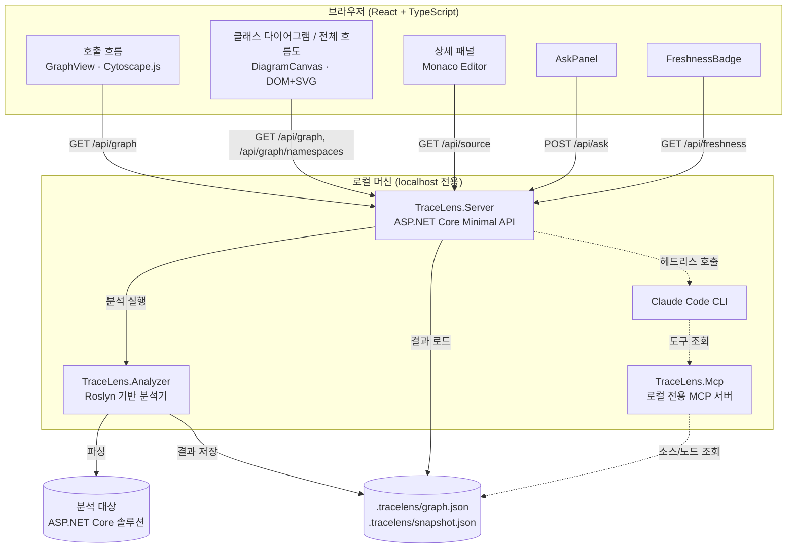

# TraceLens

ASP.NET Core Web API 코드베이스의 호출 흐름을 그래프로 탐색하고, 선택한 코드 위치를 Claude Code에게 곧바로 질의할 수 있는 로컬 개발 도구다.

## 이 도구가 하는 일

HTTP 엔드포인트(진입점)부터 시작해서 컨트롤러 → 서비스 → 리포지토리로 이어지는 실제 메서드 호출 흐름을 그래프로 보여준다. 코드베이스 전체가 어떻게 생겼는지 보고 싶으면 클래스 다이어그램이나 전체 흐름도로 전환한다. 어느 보기에서든 박스나 멤버 줄을 클릭하면 그 위치의 실제 소스 코드가 옆에 뜨고, 질문을 입력하면 파일 경로·라인 범위·심볼명이 자동으로 캡처되어 Claude Code에게 전달된다.

## 여섯 가지 보기

화면 위 툴바에서 **호출 흐름 · 클래스 다이어그램 · 전체 흐름도 · 시작 흐름 · DB·캐시 · 미들웨어**를 전환한다. 보기를 바꾸면 좌측 패널과 가운데 캔버스가 한 세트로 바뀌고, 오른쪽의 상세·질문 패널은 그대로 이어진다. 세 패널 사이의 경계선은 드래그해서 폭을 바꿀 수 있고(더블클릭하면 기본값), 창을 키우면 그만큼 넓게 쓴다.

### 호출 흐름 — 진입점 하나를 단계식으로 파고든다

왼쪽에서 라우트를 고르면 그 진입점에서 분기 지점까지를 먼저 그리고, `⊕`가 붙은 노드를 눌러 한 단계씩 펼친다. 오른쪽에는 고른 메서드의 시그니처·접근제한자·호출 관계와 실제 소스가 뜬다.

### 클래스 다이어그램 — 솔루션 전체를 UML로 한 번에 본다

모든 타입을 UML 박스(이름 / 필드 / 메서드 3단)로 한 캔버스에 그린다. 기본 배치는 **트리(계층)** 다 — 관계 방향으로 층을 나누고(상속·구현은 상위 타입이 왼쪽), 층을 건너뛰는 선에는 중간 경유점을 끼워 넣은 뒤 층마다 순서를 바꿔가며 교차를 줄인다. 진행 방향은 `→`/`↓`로 바꾸고, 네임스페이스로 묶어 보고 싶으면 **패키지** 배치로 전환한다.

관계는 네 종류를 선으로 구분한다.

| 관계 | 선 모양 | 어디서 나오나 |
|---|---|---|
| 상속 | 실선 + 빈 삼각형 | `baseTypeId` |
| 구현 | 점선 + 빈 삼각형 | `interfaceIds` |
| 연관 | 실선 + 열린 화살표 | 필드·프로퍼티의 타입(대부분 DI 주입) |
| 의존 | 점선 + 열린 화살표 | 호출 엣지 중 위 세 관계에 없는 것만 |

전체를 그리는 게 목적이라 노드를 줄이는 대신 **보는 밀도를 조절하는 손잡이**를 뒀다. 멤버(필드·메서드) 접기, 관계 4종 개별 토글(의존은 기본 꺼짐), 네임스페이스 체크박스, "선택 1홉만", 줌 50/75/100/맞춤이다. 클래스가 150개를 넘으면 멤버 접힘 + 의존 끔으로 시작하고 범위를 좁히라는 안내를 띄운다.

### 전체 흐름도 — 진입점 지도에서 전 구간 흐름으로

기본 화면은 컨트롤러 박스에 라우트가 줄로 붙은 클래스 단위 지도다. 라우트 줄을 누르면 그 진입점의 **메서드 단위 전 구간 흐름**으로 들어가고, breadcrumb으로 지도에 돌아온다.

도달한 메서드를 클래스로 묶어 박스로 만들고, 선은 어느 메서드가 어느 메서드를 부르는지 보이도록 줄 ↔ 줄로 잇는다. 깊이 제한(2/3/4/전체)에 걸려 안 보이는 하위 호출은 그 줄 오른쪽에 `+n`으로, 자기 자신을 부르는 재귀는 `↺`로 남는다.

### DB · 캐시 — 무엇을 어떤 순서로 바꾸고, 실패하면 무엇이 남는가

SQL 리터럴과 캐시 호출에서 **어느 저장소의 무엇을 읽고 쓰는지**를 모아, 진입점별 실행 경로 · 클래스 × 테이블 접근 지도 ·
트랜잭션 경계 · 점검 결과로 보여준다. 이 보기의 중심은 **보상 처리**다.

트랜잭션 없이 저장소를 두 번 이상 바꾸는 경로를 찾아, 단계마다 실패 경로(`catch` · 조기 `return`)에서 역연산을 찾았는지 판정하고
**"i번에서 실패하면 무엇이 남는가"를 격자로** 편다. 빨간 칸이 되돌리는 코드를 찾지 못한 자리다.
`catch`에는 되돌리기가 있는데 `if (!ok) return` 경로에는 없는, 눈으로 놓치기 쉬운 자리도 규칙(`COMP-006`)으로 잡는다.

샤딩은 선택이다. `tracelens.config.json`의 `dataSources`에 샤드를 잡은 경우에만 SHARD 규칙군이 켜진다.

### 미들웨어 — 요청이 무엇을 통과하고 어디서 끊기는가

`app.UseXxx()` 순서를 그대로 세우고, 솔루션 안에 있는 미들웨어는 `InvokeAsync` 본문을 열어 `_next` 앞뒤를
**요청 시 / 응답 시**로 나눠 보여준다. `_next`를 부르지 않고 끝나는 분기는 단락 지점으로 잡아 상태 코드와 함께 표시하고,
"단락 지점" 보기에서 그때 **실행되지 않는 것**과 **그래도 실행되는 응답 후처리**를 나란히 놓는다.
인증·인가·CORS 순서, 생성자에 Scoped 서비스를 받는 미들웨어, 엔드포인트 매핑 뒤에 등록해 실행되지 않는 미들웨어도 함께 잡는다.

## 왜 만들었나

큰 ASP.NET Core 코드베이스를 새로 파악하거나 다른 사람에게 설명할 때, 코드를 눈으로 따라가며 구조를 재구성하는 데 시간이 많이 든다. 기존 오픈소스 도구들은 아키텍처 다이어그램은 잘 그려주지만 "그 노드를 클릭하면 실제 코드가 보이고, 그 자리에서 바로 AI 에이전트에게 물어볼 수 있는" 흐름까지는 지원하지 않아서 직접 만들기로 했다.

## 핵심 기능

- 진입점(HTTP 엔드포인트) 기준으로 단계식으로 펼쳐지는 호출 흐름 그래프
- 솔루션 전체를 상속·구현·연관·의존으로 잇는 UML 클래스 다이어그램(트리 배치 / 패키지 배치)
- 진입점 지도와, 라우트를 눌러 들어가는 메서드 단위 전 구간 흐름도
- 노드 클릭 시 실제 소스 코드로 드릴다운, breadcrumb으로 이전 단계 이동
- 보기·필터·선택 상태를 저장해서 새로고침이나 재분석 후에도 보던 화면을 유지
- 선택한 위치를 Claude Code에게 질의 — 클립보드 복사 / 로컬 MCP 직접 연동 / 에디터에서 열기, 세 가지 방식 지원
- 마지막 분석 시점과 현재 코드가 같은지 보여주는 신선도 표시, 필요할 때만 수동으로 재분석
- DB·캐시 접근 지도와 **보상 처리(수동 롤백) 점검** — 트랜잭션 없는 쓰기 경로에서 무엇이 되돌려지지 않는지 격자로 표시
- 미들웨어 파이프라인의 요청/응답 구간·단락 지점과 순서 점검
- 점검 결과는 언제나 근거 체인과 확실도(확실/추정)를 함께 보여주고, 검사하지 않는 규칙도 목록에 남긴다
- 분석 대상은 솔루션(`.sln`)과 프로젝트(`.csproj`) 모두 지원하고, 폴더 탐색 대화상자로 골라서 지정

## 아키텍처



## 기술 스택

| 영역 | 선택 | 비고 |
|---|---|---|
| 분석기 | C# / Roslyn (Microsoft.CodeAnalysis) | 메서드 호출 관계와 파일·라인 정보를 정확히 추출 |
| 서버 | ASP.NET Core Minimal API | 그래프 서빙, 소스 서빙, React 정적 파일 호스팅을 겸함 |
| 프론트엔드 | React + TypeScript (Vite) | 호출 흐름은 Cytoscape.js, 클래스 다이어그램·전체 흐름도는 DOM+SVG 직접 렌더, 코드 뷰는 Monaco Editor |
| 데이터 저장 | JSON 파일 (`.tracelens/` 아래) | 구현 단순함 우선, 필요해지면 이후 교체 검토 |
| 에이전트 연동 | Claude Code CLI + 로컬 MCP 서버 | 원격 노출 없이 로컬에서만 동작 |

## 시작하기

### 요구사항

- .NET 8 이상 SDK
- Node.js 20 이상
- Claude Code CLI (3단계 기능을 쓸 경우)

### 설치 및 실행 (명령 하나)

```powershell
git clone <repo-url> tracelens
cd tracelens

.\run.ps1
```

`run.ps1`이 클라이언트 의존성 설치 → 서버 빌드 → 클라이언트 프로덕션 빌드까지 한 번에 하고 서버를 띄운다.
클라이언트 빌드 결과는 `src/TraceLens.Server/wwwroot`로 들어가서 서버가 그대로 호스팅하므로, 브라우저에서 <http://127.0.0.1:25011> 하나만 열면 된다(준비되면 자동으로 열린다).

| 옵션 | 설명 |
|---|---|
| `.\run.ps1` | 클라이언트를 빌드해서 서버 하나로 실행한다(<http://127.0.0.1:25011>). 평소 도구를 쓸 때 쓴다. |
| `.\run.ps1 -Dev` | API 서버(25011)와 Vite 개발 서버(25012)를 함께 띄운다. 클라이언트를 고치면서 HMR로 확인할 때 쓴다. 브라우저는 <http://localhost:25012>으로 연다. |
| `.\run.ps1 -SkipBuild` | 빌드를 건너뛰고 바로 실행한다. |
| `.\run.ps1 -NoBrowser` | 브라우저를 자동으로 열지 않는다. |

Ctrl+C로 종료하며, `-Dev` 모드에서는 백그라운드로 띄운 API 서버까지 함께 정리한다.

### 직접 실행 (스크립트 없이)

```bash
# 백엔드
dotnet build
dotnet run --project src/TraceLens.Server

# 프론트엔드 (다른 터미널에서)
cd client
npm install
npm run dev
```

### 분석 대상 지정

화면 위쪽 입력란에 분석할 경로를 직접 입력하거나 **찾아보기…** 버튼으로 폴더를 탐색해서 고른다.
솔루션(`.sln`)과 프로젝트(`.csproj`)를 모두 고를 수 있고, `.csproj`를 고르면 그 프로젝트와 그 프로젝트가 참조하는 프로젝트만 분석한다(큰 솔루션에서 필요한 부분만 빠르게 볼 때 쓴다).

## 폴더 구조

세부 폴더 구조와 각 파일의 책임은 CLAUDE.md의 "저장소 구조" 절을 참고한다.

## 현재 개발 단계

1~6단계 구현이 모두 끝났다. 현재 상태와 남은 작업은 `git log`와 코드를 직접 확인한다.
