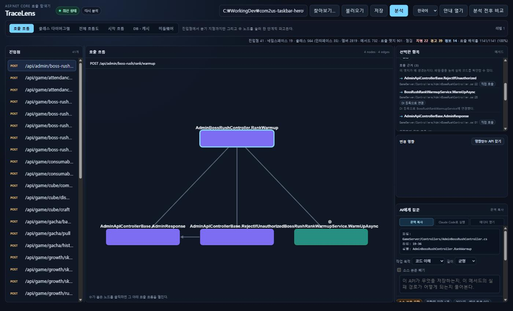
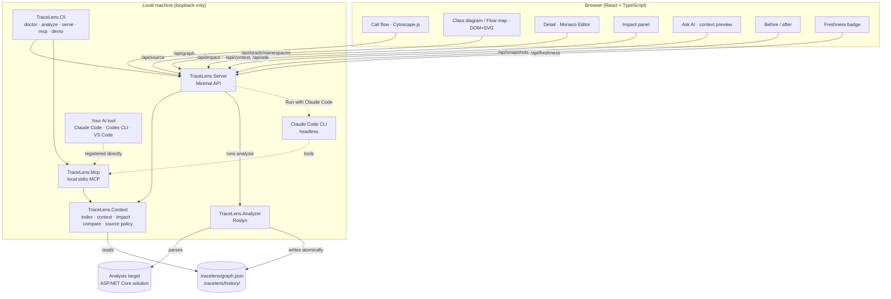

*English · [한국어](README_kr.md)*

# TraceLens

**A local development tool that shows the call path of an ASP.NET Core Web API together with the code behind it, and hands an AI coding agent the context it needs — with the evidence attached.**

Everything here comes from reading your source **statically**. TraceLens does not collect runtime
traces or timings — the "Trace" in the name means following call paths through code, not distributed
tracing.

## Build and run

Install the **.NET 10 SDK** and Node.js 20 or later, then run these commands in PowerShell:

```powershell
git clone https://github.com/jacking75/DotNetApiServerTraceLens.git tracelens
cd tracelens
dotnet --version       # should print 10.x
.\run.ps1
```

`run.ps1` installs the client dependencies, builds TraceLens, starts it, and opens
<http://127.0.0.1:25011>. Press `Ctrl+C` in the terminal to stop it.

### Single executable for Windows 11

Run `.\pack-desktop.ps1` to produce `artifacts/TraceLens.Desktop-win-x64.exe`.
The EXE opens the existing UI in a WebView2 window and stops its loopback server when the window closes.
Use `TraceLens.Desktop-win-x64.exe --target <solution or project path>` to load a saved analysis at startup;
re-analysis remains an explicit UI action. The target machine needs the **.NET 10 Desktop Runtime,
ASP.NET Core Runtime, and WebView2 Runtime**, but neither Node.js nor the source repository.
Analyzing a solution or project also requires a **.NET SDK** capable of building that target.
On first launch, bundled assets are extracted under `%LOCALAPPDATA%\TraceLens\desktop-assets`.
The existing browser and Vite development workflow remains available. This desktop build targets Windows 11 x64.
See the [Windows 11 desktop guide](docs/desktop.md) for first-time builds, `-SkipClient`, run commands,
cache locations, and the relationship to the existing CLI.

```
# Packaged build: .\tracelens.exe · From source: dotnet run --project src/TraceLens.Cli --
1) tracelens analyze <your .sln, .slnx, or .csproj> # analyzes and writes .tracelens/graph.json
2) tracelens serve   --target <same path>         # opens the UI at http://127.0.0.1:25011
3) pick an entry point → check the source → copy AI context   # evidence and limits come along
4) after the AI edits code → "Re-analyze and compare"          # see what actually changed
```



*Analyzing a real multi-controller service (41 entry points, 564 classes, 732 methods) — not a toy example. The detail panel on the right shows, for every edge, why it exists: direct call, resolved via DI registration, or an estimated single-implementation guess. More screens in [docs/manual.html](docs/manual.html).*

---

## Why you would want this

Five situations this was built for. Each one is a question that is annoying to answer by reading
files, and dangerous to answer by guessing.

| The situation | Without a tool | With TraceLens |
|---|---|---|
| **"What does this API actually do?"** | Open the controller, find the interface, find the implementation, find the repository, hope you did not miss a branch. | Pick the route, see the whole path from entry point to storage, click any step to read the real source. |
| **"I want to ask an AI about this code."** | Paste a file path and a line range by hand, and hope the model does not invent the rest. | One click builds a context with the signature, the verified source, the path from the entry point, the call evidence, and what the analysis could *not* see. |
| **"If I change this method, what breaks?"** | grep the method name, then grep the interface name, then hope nothing uses DI indirection. | Walk callers backwards to every HTTP entry point that reaches it, with the evidence path for each. |
| **"This write path has no transaction. What is left behind if step 2 fails?"** | Trace `catch` blocks and early returns by eye, per method. | A grid answering "if step *i* fails, what does not get rolled back", with the reason for each verdict. |
| **"The AI changed my code. What actually changed?"** | Read a text diff and hope you notice the call-graph consequences. | Compare against a saved baseline: endpoints, method bodies, call edges, data access, findings. |

The common thread: **you can check the answer.** Every claim TraceLens makes points at a file and a
line, and says how confident it is.

---

## What makes it different

These are design choices, not benchmark results. TraceLens is not claiming to be better than tools
like NDepend — it is picking a narrower seat and being strict about a few things.

### 1. Every conclusion carries its evidence

An edge in the graph is not just "A calls B". It records **where** (file and line) and **how it was
resolved**:

| Resolution | Meaning | Confidence |
|---|---|---|
| `Direct` | The declared symbol is the implementation. | certain |
| `DiRegistration` | An interface call resolved through `AddScoped<I, Impl>` and friends. | certain |
| `SingleImplementation` | No DI registration, but exactly one implementation exists in the solution. | **estimated** |
| `Ambiguous` | Several candidates. **No edge is created** — the reason is recorded instead. | — |
| `Unresolved` | The symbol could not be resolved (compile error, unsupported syntax). | — |
| `External` | A call outside the solution (framework, package). No edge, and **excluded from the resolution-rate denominator.** | — |

`External` stays out of the denominator because counting framework calls would turn the
"resolution rate" into a measure of how much framework you use, not of how well your code was read.

So when an AI answers "this controller writes to the `orders` table", you can follow `call:3` to
`Controllers/OrdersController.cs:22` and check it yourself.

### 2. It tells you what it could *not* see

A graph with a hole looks exactly like a graph with no calls. TraceLens refuses that ambiguity:

- **Resolution rate** with the denominator spelled out — `resolved / inspected call sites that target in-solution code`. Never a bare "95% accurate".
- **Boundaries** — unresolved and ambiguous calls are listed separately, so an empty caller list never silently means "nothing calls this".
- **Rules that were not checked stay in the catalog marked "off"**, so you know which checks did not run.
- Projects that failed to compile, depth limits that were hit, and namespaces excluded by config are all reported.
- "No callers found" is never rendered as "safe to delete".

### 3. One context contract, every destination

The clipboard, the in-app Claude Code run, and all twelve MCP tools are served by **the same
endpoint** (`POST /api/context`). There is no second, slightly-different context assembled somewhere
else — so what you preview is exactly what the model receives.

### 4. Local by construction

Analysis runs on your machine with Roslyn. The server binds to loopback only and there is no option
to expose it. The MCP server is local stdio. The one time your code leaves the machine is when *you*
send it to an external AI — and there is a preview, an "exclude source text" switch, and per-file
exclusion before that happens.

### 5. Freshness is explicit, re-analysis is yours

Nothing is watched in the background; nothing re-analyzes itself. Instead you always see whether the
analysis still matches the code — including **newly added `.cs` files** and **config changes**, not
just edits to files it already knew about. When it cannot tell, it says `unknown` rather than
`fresh`.

### 6. Built for ASP.NET Core specifically

Not a generic dependency grapher. It understands controller attributes *and* minimal API
registration, DI lifetimes, the middleware pipeline, and transaction-free write paths — the things
you actually ask about in a request-handling codebase.

---

## Features

### Six views

The toolbar switches views; the left panel and center canvas swap together, and the detail/ask column
on the right stays put. All three panes are resizable (double-click a divider to reset).

#### Call flow — one entry point, step by step

Pick a route on the left. It draws from that entry point to the nearest branch point, and clicking a
node marked `⊕` expands **two hops** from it — not one, because one hop usually reveals a single
pass-through method and makes you click again. A window holds at most **120 nodes**; anything beyond
that is counted as "N more". This keeps a large solution readable: you go where you are curious
instead of rendering ten thousand nodes.

The detail panel shows the selected method's signature, accessibility, declaring class, routes,
direct callers and callees — and the **call evidence** behind each of those edges.

#### Class diagram — the whole solution as UML

Every type is a UML box (name / fields / methods). The default layout is **tree**: types are placed
in layers following relationship direction, edges that skip layers are routed through waypoints, and
rows are reordered per layer to reduce crossings. Switch direction with `→`/`↓`, or use **package**
layout to group by namespace.

Four relationship kinds, each with its own line style:

| Relationship | Line | Derived from |
|---|---|---|
| Inheritance | solid + hollow triangle | `baseTypeId` |
| Implementation | dashed + hollow triangle | `interfaceIds` |
| Association | solid + open arrow | field/property types (usually DI injection) |
| Dependency | dashed + open arrow | call edges not already covered above |

Because the point is to draw *everything*, the answer to size is **density controls**, not trimming
nodes: collapse members, toggle each relationship kind (dependency is off by default), namespace
checkboxes, "1 hop from selection", and zoom at 50/75/100%/fit. Past **150 classes** it starts with
members collapsed, dependency off and zoom-to-fit, and tells you to narrow the scope.

#### Flow map — from an entry-point map to the full path

The default screen is a class-level map with controller boxes and their routes as rows. Click a route
row and you drop into that entry point's **full, method-level path**, with a breadcrumb back.

Reached methods are grouped into class boxes and lines connect row ↔ row. Sub-calls hidden by the
depth limit (2/3/4/all) show as `+n` on that row; recursive self-calls are marked `↺`.

#### Startup flow — Program.cs in the order it runs

A two-track timeline built by reading Program.cs in source order: **service registrations** (which
interface maps to which implementation, with Scoped/Singleton/Transient lifetime) and the
**middleware/routing pipeline** (`app.UseXxx()` / `MapXxx()`). Extension methods defined in the
solution (`AddFixtureServices()`) start collapsed and expand to show what they really register.

#### Data & cache — what changes, in what order, what is left behind

Storage access is read from SQL literals and cache calls, then presented as: per-entry-point
execution path · class × table access map · transaction boundaries · findings.

The centerpiece is **compensation analysis**. It finds paths that touch storage more than once
without a transaction, checks at each step whether the failure path (`catch` / early `return`)
contains an undo, and lays out a grid answering *"if step i fails, what stays behind?"* A red cell
means no undoing code was found there. Each step gets a verdict:

| Verdict | Meaning |
|---|---|
| `Transaction` | Covered by a transaction; rolls back. |
| `Yes` | An explicit undo call was found on the failure path. |
| `PartialPaths` | Some failure paths undo it, others do not. |
| `No` | Nothing undoes it — it stays behind. |
| `NotNeeded` | Cache invalidation and similar — safe to repeat. |
| `Irreversible` | No cancel exists (a sent notification, an append-only ledger). |

Rule `COMP-006` catches the easy-to-miss case where a `catch` has an undo but an early-return path
like `if (!ok) return` does not. Sharding rules only switch on when `tracelens.config.json` declares
a shard, so you do not get noise about a concept your system does not use.

The catalog holds **42 rules**, of which **26 run by default** (12 off, 4 that need a declared shard).
They span `COMP` (compensation), `TX`, `CACHE`, `CONN`, `RW`, `SHARD`, `PERF`, `IDX`, `MAP`, `SEC`
and `MW`. Every finding carries evidence and a confidence level; a rule that did not run is never
removed from the list — it stays there as "off".

#### Middleware — what a request passes through, and where it stops

Lays out `app.UseXxx()` registration order as-is. For middleware defined in the solution it opens the
`InvokeAsync` body and splits it into **on-request** and **on-response** halves around the `_next`
call. Branches that return without calling `_next` are flagged as short-circuit points with their
status code. It also catches authentication/authorization/CORS ordering problems, middleware taking a
Scoped service through its constructor, and middleware registered after endpoint mapping that never
actually runs.

---

### AI context — the part that makes an agent useful

Select anything (entry point, method, class, namespace, finding, write path, middleware step) and the
**Ask AI** panel builds a task context. It is assembled by deterministic rules — no LLM call is
involved in building it — in this priority order:

1. Your **intent** and question, plus the identifiers of what you selected
2. Analysis time, `snapshotId`, **freshness**, analysis scope, and the significant unresolved reasons
3. The selected method's signature and a **verified** source range — marked `snapshot` or `current` depending on whether the file still matches the analysis
4. The **representative call path** from the entry point to the target, with the evidence for each call site
5. Direct callers and callees, plus related database, cache and middleware findings
6. **Test candidates** found in the graph — labelled `reached in graph` vs `name match only`, and never presented as "the tests pass"
7. What was omitted for length, and how to fetch more

**Intent** — four of them (understand code / plan a change / review a change / investigate data) —
changes what gets priority. The API has a fifth value, `Share`, which is deliberately not in the
dropdown: it belongs to the share-report button, where the point is to strip source bodies and
absolute paths, and mixing it into the "ask" flow would only confuse the two. **Length** (short / balanced / detailed) is enforced by deterministic caps on characters,
nodes and source lines, so the same selection with the same budget always produces the same context.

Three ways to use it:

| Mode | What happens | Requires |
|---|---|---|
| **Copy context** | Markdown on your clipboard. Paste into any AI tool. Works for *any* selection, including classes with no runnable node. | nothing |
| **Run with Claude Code** | Streams the answer in the browser. The server runs the CLI headlessly with the same context and the MCP tools attached — no registration needed. | Claude Code CLI on PATH |
| **Open in editor** | Jumps to the location in VS Code (falls back to a `vscode://` URI). | `code` on PATH (optional) |

Before you send anything, the preview shows **which files are included, whether source text is in
there, the length and estimated tokens, what was omitted, and the limitations**. When the analysis is
`stale`, source text is deliberately left out of an editing context — pinning current code onto stale
line numbers and calling it "the code as analyzed" would be a lie.

### MCP — connect it to the AI tool you already use

A local stdio MCP server exposes twelve tools. "Show MCP setup" in the ask panel prints a snippet
with your real paths filled in for Claude Code, Codex CLI, VS Code or Cursor, plus a **one-liner you
can paste straight into a terminal** — and never overwrites your existing config. The same dialog has
an "Agent guide" tab with a section to paste into the target repository's `CLAUDE.md`/`AGENTS.md`;
without it the agent will grep around as usual.

| Tool | What it returns | Ask it like this |
|---|---|---|
| `get_analysis_status` | Target, timestamp, freshness, capabilities, diagnostics. **Call this first.** `suggestedNextTools` in the response points at the next tool. | (first, whatever the question) |
| `get_entrypoints` | The list of HTTP entry points | "What APIs does this service expose?" |
| `get_entrypoint_flow` | One entry point's bounded call path and its boundaries | "What does POST /api/orders call, in what order?" |
| `get_context` | The same task context the UI previews | "Explain what this endpoint does from input to storage, citing the evidence ids" |
| `search_symbol` | Node search by name or namespace | "Where is CreateOrderAsync?" |
| `get_impact` | Entry points that may be affected by changing a method | "If I change this method, which APIs are affected and which tests are needed?" |
| `get_findings` | Findings with confidence, plus the list of disabled rules | "If step 2 of this write path fails, what is left behind?" (`ruleId=COMP-`) |
| `compare_snapshots` | Differences against a saved baseline | "Does this change introduce unintended call path changes?" |
| `get_node` · `get_source` · `get_callers` · `get_callees` | Nodes, source, adjacent calls with evidence | "What does this line actually call?" |

Every tool reads an already-saved analysis and **never re-analyzes**. Responses carry a `snapshotId`;
pass it back as `expectedSnapshotId` and you get a `SNAPSHOT_MISMATCH` if the analysis changed
underneath you. List tools page with `limit`/`cursor` so a large solution does not flood the model's
context.

### Change impact — before you edit

Select a method, press **Find affected APIs**, and it walks callers backwards to every HTTP entry
point that reaches it, returning **one representative shortest path** per endpoint with the evidence
for each step. Picking one opens it in the existing call-flow view — several entry points are never
unfolded into one unreadable graph.

What it does **not** prove is stated in the result: property/DTO shape changes, reflection, external
calls, event subscriptions and runtime DI selection. "No callers found" means *no callers were
found*, not "safe to delete" — a job or a message consumer may still run it.

### Before / after comparison — after the AI edits

Press **Save as "before"**, let the AI change the code, then press **Re-analyze and compare**
(re-analysis still only happens because you pressed it).

| Section | What you see |
|---|---|
| Endpoints | Added, removed, handler changes |
| Methods | Added, removed, **signature** and **body** changes — the body fingerprint ignores whitespace and comments |
| Calls | Edges added/removed, and **changes in resolution evidence or confidence** on an existing edge |
| Data & cache | Access added/removed, and moves in or out of a transaction |
| Findings | New findings, and findings that disappeared |
| Possible renames | Removed/added pairs with the same body fingerprint — **never auto-confirmed** |

Preconditions are checked first: if the target, analyzer version, rules version or analysis scope
differ, it says the comparison conditions are not the same. A finding that vanished because its rule
was turned off is reported as **not comparable**, never as "fixed". And "no differences" is not
"safe" and not "the tests pass".

### Freshness and re-analysis

| State | Meaning |
|---|---|
| `fresh` | Every recorded input matches what is on disk. |
| `stale` | Something changed or was deleted, a **new `.cs`** appeared, or a config input changed. |
| `unknown` | The check could not cover it (for example an analysis saved in an older format). Never reported as `fresh`. |

The badge re-checks every 30 seconds. That check is a file-list and hash comparison only — it never
runs an analysis. Tracked inputs include every source file the analysis read, the `.sln`/`.csproj`,
`tracelens.config.json`, `Directory.Build.props/targets`, `Directory.Packages.props`, `global.json`,
and the **set** of `.cs` files under the project folders.

### Saving, sharing and importing

- **Save** the analysis to a file, **open** it later without re-analyzing.
- An imported graph is treated as an `offlineSnapshot`: its `rootDirectory` alone does not grant local file access, source viewing stays closed until you attach the original root and the inputs match, and the target's active `graph.json` is never overwritten.
- **Share report** exports just the selected scope as Markdown, with absolute paths and source text excluded by default, and optional masking of table/key names.

### Command line and distribution

```text
tracelens doctor  [--target <path>] [--json]   Checks the environment; never installs or changes settings.
tracelens analyze <path> [--json] [--profile] [--output <dir>] [--config <file>]
                                               One analysis, with a summary of what it did and did not see.
tracelens serve   [--target <path>] [--port n] [--no-browser]
                                               The UI server (loopback only).
tracelens impact  <target> --node <id|"Class.Method"> [--changed-files a.cs,b.cs] [--json]
                                               Impact candidate endpoints from the stored result (never re-analyzes).
tracelens context <target> --node <id> [--kind …] [--intent …] [--budget …] [--json]
                                               Prints the context for an AI agent to stdout (Markdown by default).
tracelens compare <target> --baseline <snapshotId|latest> [--list] [--json]
                                               Compares a saved baseline with the current analysis.
tracelens mcp     --graph <graph.json path>    The local stdio MCP server.
tracelens demo    [--dir <destination>]        Copies the example project and explains what to look at.
tracelens init    [--target <path>] [--force]  Writes tracelens.config.json. Never overwrites an existing one.
tracelens config  --show [--target <path>]     Prints the effective config (defaults merged with your file).

Do not analyze the same target from two instances (on different ports) at once: both write to the same
`.tracelens/` and the one that finishes last wins (the 409 rejection only works within a single process).
Stop with `Ctrl+C`, or `Get-Process tracelens | Stop-Process` if you started it in the background.
```

`--no-browser` skips opening a browser (for remote shells and containers). `--profile` prints
per-stage times and the peak working set alongside the summary.

`impact`, `context` and `compare` read `.tracelens/graph.json` **without starting the server**, so they
work in CI and PR hooks. They report through exit codes (`tracelens --help` prints the same table).

| Exit code | Meaning | What automation should do |
| --- | --- | --- |
| `0` | Success | Use the output as is. |
| `1` | Failure | No analysis was found, or the file could not be read. Run `tracelens analyze` first. |
| `2` | Bad arguments | The target or `--node` is missing. Fix the command line. |
| `3` | Compare preconditions differ | Target, analyzer version, rules version or analysis scope differ. **Do not read "no differences" as safe.** |
| `4` | Analysis is stale | The output reflects older code. Re-analyze and run again (nothing re-analyzes on its own). |

**Where the result is written.** For a `.sln`, `.tracelens/graph.json` sits next to the solution.
For a `.csproj` it goes under the **common parent folder that holds the project and everything it
references** — not the project folder. The actual path is printed as `outputPath` by `analyze`, and
`serve` walks up to 8 levels from the target to find it.
If the target is a git repository, add `.tracelens/` to its `.gitignore` (`analyze` prints the same tip).

`doctor` reports codes like `SDK_NOT_FOUND`, `SDK_MISMATCH`, `TARGET_NOT_FOUND`,
`UNSUPPORTED_TARGET_FORMAT`, `OUTPUT_NOT_WRITABLE`, `PORT_IN_USE`, `MCP_HOST_MISSING` with a
suggested next action — so a failed setup tells you what to fix instead of just failing.

`.\pack.ps1` builds a Windows x64 portable ZIP and a .NET tool package into `artifacts/`, with
checksums, versions and manual verification steps in `manifest.txt`. It builds only; it never
publishes. `-Runtimes @('win-x64','linux-x64','osx-arm64')` produces one ZIP per RID —
**building a ZIP is not the same as supporting that OS**, and the support table below stays as it is
until someone runs doctor, analyze, serve and source viewing there.

Long analyses report progress by **stage** (load · entrypoints · scan · rules · save) with real
counts — no invented percentage — and can be **canceled**, which keeps the previous analysis intact.

### Other things worth knowing

- **Korean and English UI.** The Korean dictionary is the source of truth and the English one is type-constrained by its keys, so a missing translation is a compile error. Symbols, routes, code and file paths are never translated. Rule names and descriptions are translated (all 42, keyed by rule id); the text of an individual finding is not — it is composed at analysis time from your own symbol and table names, and the tool shows it as the analyzer wrote it rather than pretending to translate it.
- **View state persists.** The view, filters and selection you were looking at survive a refresh and a re-analysis; only selections pointing at code that no longer exists get cleared.
- **First-run guidance.** Before anything is analyzed you get the example, your own project, the supported scope, and four recipes — not an empty canvas.
- **Configurable for your codebase.** `tracelens.config.json` lets you point `db.queryApis` at your in-house data wrapper, set `analysisScope`, `maxCallDepth`, excluded namespaces, and turn individual collectors off.

---

## Getting started

### What you need

| Requirement | When it is needed |
|---|---|
| .NET 10 SDK or later | Always. It builds and runs TraceLens, and opens the project you analyze. |
| Node.js 20 or later | **Only when building from source.** Not needed with the released ZIP or .NET tool. |
| Claude Code CLI | Only for "Run with Claude Code". Copying context works without it. |
| Codex CLI / VS Code | Only if you want to register the MCP server directly ([docs/mcp-setup.md](docs/mcp-setup.md)). |

### Start from the build output (no source tree, no Node.js)

> **There is no published distribution yet.** Nothing is on nuget.org or GitHub Releases, so there is
> nowhere to download from. Build it with `.\pack.ps1` on a machine that has the source (only that
> machine needs Node.js) and copy the result, or use "Run from source" below. When a publishing channel
> exists, this paragraph becomes a link to it.

```powershell
# Unpack the ZIP produced from this repository, then:
.\tracelens.exe doctor --target C:\repos\MyApp\MyApp.sln   # check the environment first
.\tracelens.exe demo --dir C:\temp\tracelens-demo          # copy the example project
.\tracelens.exe analyze C:\temp\tracelens-demo\OrderApi\OrderApi.csproj
.\tracelens.exe serve   --target C:\temp\tracelens-demo\OrderApi\OrderApi.csproj
```

The example (`samples/OrderApi`) is built to show the interesting cases in one place: four controller
routes (including two routes on one method) and four minimal API routes calling the same services,
plus a four-step write path with no transaction and no compensation.

### Run from source

```powershell
git clone https://github.com/jacking75/DotNetApiServerTraceLens.git tracelens
cd tracelens
.\run.ps1
```

`run.ps1` installs client dependencies, builds the server, builds the client for production and
starts the server. Open <http://127.0.0.1:25011>.

| Option | Description |
|---|---|
| `.\run.ps1` | Builds the client and serves everything from one server. The everyday path. |
| `.\run.ps1 -Dev` | API server (25011) + Vite dev server (25012), for client work with HMR. |
| `.\run.ps1 -SkipBuild` | Skips the build and runs immediately (Node.js is not needed in this mode). |
| `.\run.ps1 -NoBrowser` | Does not open a browser. |

Client checks are `cd client; npm test` (vitest) and `npm run build` (includes type checking).
`npm run screenshots` attaches headless Chrome to a running server (<http://127.0.0.1:25011> by
default) and captures the six views in both themes and two window sizes into `docs/screenshots/` —
useful for eyeballing the light theme.
`npm run profile` attaches the same way and counts React commits and `/api/*` requests for a
splitter drag, an entry-point selection and typing a question (numbers go in the CHANGELOG).

### Pointing at a target

Type the path in the header or use **Browse…**. You can point at a solution (`.sln` or `.slnx`) or a single
project (`.csproj`) — a `.csproj` analyzes that project and the projects it references, which is
handy for looking at one slice of a large solution.

---

## What is supported today

| Area | Support | Notes |
|---|---|---|
| Controller entry points | Supported | `[HttpGet]`-family attributes plus `[Route]`. Two routes on one method become two endpoints. |
| Minimal API entry points | Supported | `MapGet/MapPost/MapPut/MapDelete/MapPatch/MapMethods/Map`, `MapGroup` prefixes (including nesting), and method-group, lambda and local-function handlers. |
| Registrations inside extension methods | Supported (estimated) | Follows `app.MapFeatureEndpoints()` style registration up to depth 4, and says the prefix came from the call site. |
| Dynamic routes | Not supported | The literal source text is shown and the endpoint is marked **estimated**. |
| Interface calls | Supported | Resolved through DI registrations. Without one, it connects only when exactly one implementation exists, and marks that **estimated**. |
| Keyed / conditional DI registrations | Not asserted | Which implementation runs cannot be decided statically, so no edge is created and the reason is recorded. |
| Database and cache access | Supported (configurable) | Read from SQL literals and cache calls. Point `db.queryApis` at your own wrapper types. |
| Reflection, event subscriptions, message handlers | Not supported | Never turned into call edges. |
| Target formats | `.sln`, `.slnx`, `.csproj` | `.slnx` requires the .NET 10 SDK. |

### What is not read today

The items below are **absent from the results** — but they do not vanish silently. Their counts and
names are recorded under "input seen but not interpreted" and "execution units outside HTTP" in the
analysis diagnostics, and known frameworks are also promoted to a limitation sentence.

| Not read | How it shows up |
|---|---|
| EF Core, MongoDB, NHibernate storage access | 0 data access entries plus the reason in `dataAccess.notes`, and a count in the external-namespace tally |
| MediatR `Send()`→handler, delegate and event dispatch | No call edge, plus a count in the external-namespace tally |
| gRPC, SignalR, `BackgroundService`, message consumers, Hangfire/Quartz, Azure Functions | Not counted as entry points; reported as "N execution units outside HTTP" in diagnostics, the entry point list and the impact limitations |
| MVC action and exception filters, `[Authorize]` policies | Not shown as steps in the middleware view |
| Conventional routing (`MapControllerRoute`) | Not counted as an entry point; counted only in the `ConventionalRouting` candidate group |

The classic `Startup.cs` layout (.NET Core 3.1-5) **is** read — it is merged with `Program.cs` into one timeline.

Only verified platform combinations are listed:

| Platform | Status |
|---|---|
| Windows 11 x64, .NET 10 runtime + .NET SDK | Source build and automated tests, plus launching and analyzing with the desktop EXE, verified; the portable ZIP still needs manual re-verification |
| macOS / Linux | Not verified yet. The code targets net10.0 and will likely run, but it is not listed as supported |

---

## How this relates to other tools

Commercial and open-source tools that trace callers or do impact analysis already exist. NDepend, for
example, offers impact exploration through callers and its own official MCP server
([impact analysis docs](https://www.ndepend.com/docs/refactoring-impact-analysis),
[MCP server repository](https://github.com/ndepend/NDepend.MCP.Server) — a separate license or trial
is required).

TraceLens aims narrower: tying **request-centric ASP.NET Core exploration, local static analysis,
AI context with evidence attached, and database/cache compensation checking** into one workflow,
under the MIT license. That is a positioning statement, not a measured claim of superiority.

---

## Architecture



`TraceLens.Context` is the reason the UI and an AI agent always agree: both the HTTP API and the MCP
tools build their answers from the same index, the same context builder and the same source-access
policy.

## Tech stack

| Area | Choice | Notes |
|---|---|---|
| Analysis | C# / Roslyn (Microsoft.CodeAnalysis) | Extracts method call relationships with exact file and line information |
| Shared queries | `TraceLens.Context` | Index, context, impact, comparison, source-access policy. Shared by the server and MCP |
| Server | ASP.NET Core Minimal API | Binds to loopback only. There is no option to expose it remotely |
| Frontend | React + TypeScript (Vite) | Call flow uses Cytoscape.js; other diagrams are DOM+SVG; the code view is Monaco |
| Storage | JSON under `.tracelens/` | Written to a temp file, verified, then swapped in |
| Agent integration | Local stdio MCP plus optional Claude Code CLI invocation | Nothing is exposed remotely |
| Distribution | .NET tool + Windows portable ZIP + Windows 11 desktop EXE | Carries the web assets and examples; no Node.js needed to run |

## Documentation

- [docs/manual.html](docs/manual.html) — the manual: screen layout, all six views, AI integration, real usage walkthroughs
- [docs/desktop.md](docs/desktop.md) — building, running, and distributing the Windows 11 desktop app
- [docs/mcp-setup.md](docs/mcp-setup.md) — registering the MCP server with Claude Code, Codex CLI, VS Code and Cursor
- [docs/data-contract.md](docs/data-contract.md) — the `graph.json` schema (v7), the API and MCP contracts, error codes, migration rules
- [CONTRIBUTING.md](CONTRIBUTING.md) — how to report a missed call, and what contributions are in scope
- [CHANGELOG.md](CHANGELOG.md) — release notes (updated by hand) and known limitations
- [CLAUDE.md](CLAUDE.md) — repository instructions and design constraints for AI coding agents

## License

MIT. See [LICENSE](LICENSE).
