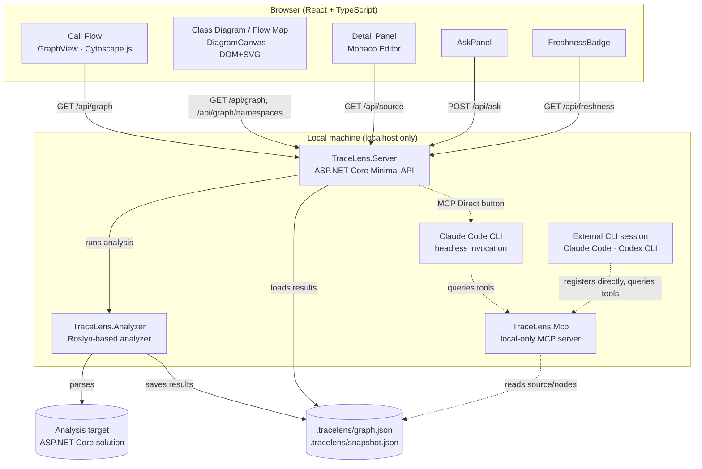

*English · [한국어](README_kr.md)*

# TraceLens

A local development tool that lets you explore the call flow of an ASP.NET Core Web API codebase as a graph, and ask an AI coding agent (Claude Code, Codex CLI, etc.) about any selected code location right away.

> For build instructions, the screen layout, all six views, AI agent integration, and real usage
> scenarios in one place, open [`docs/manual.html`](docs/manual.html) in a browser.

## What this tool does

Starting from an HTTP endpoint (entry point), it shows the real method call flow as it moves from controller → service → repository. Switch to the class diagram or the flow map to see how the whole codebase is shaped. In any view, clicking a box or a member row brings up the actual source at that location, and typing a question automatically captures the file path, line range, and symbol name and hands them to an AI coding agent.

> **Note:** TraceLens's own UI is Korean-only today — button and tab labels appear in Korean on
> screen. This document explains everything in English; screen mockups below reproduce the actual
> on-screen (Korean) text so you can match what's described here to what you'll actually see.

## Six views

Switch between **Call Flow · Class Diagram · Flow Map · Startup Flow · Data Access (DB · Cache) · Middleware** from the toolbar at the top (the tab buttons themselves are labeled in Korean: 호출 흐름 · 클래스 다이어그램 · 전체 흐름도 · 시작 흐름 · DB·캐시 · 미들웨어). Switching views swaps the left panel and the center canvas together as one set, while the detail/ask panel on the right stays put. The dividers between the three panels can be dragged to resize (double-click to reset), and the center canvas gets more room as you widen the window.

### Call Flow — drill into one entry point step by step

Pick a route on the left and it first draws up to the nearest branch point from that entry point; click a node marked `⊕` to expand one level deeper at a time. The right panel shows the selected method's signature, access modifier, call relationships, and actual source.

### Class Diagram — the whole solution as UML, at a glance

Every type is drawn as a UML box (name / fields / methods, three tiers) on one canvas. The default layout is **tree (hierarchical)** — types are arranged in layers by relationship direction (for inheritance/implementation, the parent type sits to the left); edges that skip layers get routed through waypoints, and rows are reordered layer by layer to reduce crossings. Flip the direction with `→`/`↓`, or switch to **package** layout to group by namespace.

Four kinds of relationships are drawn as distinct line styles.

| Relationship | Line style | Where it comes from |
|---|---|---|
| Inheritance | solid + hollow triangle | `baseTypeId` |
| Implementation | dashed + hollow triangle | `interfaceIds` |
| Association | solid + open arrow | the type of a field/property (mostly DI injection) |
| Dependency | dashed + open arrow | call edges not already covered by the three relationships above |

Since the point is to draw everything, instead of trimming nodes there are **density controls**: collapsing members (fields/methods), toggling each of the four relationship kinds individually (dependency is off by default), namespace checkboxes, "1 hop from selection only," and zoom at 50/75/100%/fit. Past 150 classes, it automatically starts with members collapsed, dependency off, and zoom-to-fit, and prompts you to narrow the scope.

### Flow Map — from an entry-point map to the full path

The default screen is a class-level map with controller boxes and their routes listed as rows. Clicking a route row takes you into the **full, method-level call path** for that entry point, with a breadcrumb back to the map.

Reached methods are grouped into class boxes, and lines connect row ↔ row to show which method calls which. Sub-calls hidden by the depth limit (2/3/4/all) appear as `+n` to the right of that row, and recursive self-calls are marked with `↺`.

### Startup Flow — Program.cs, in the order it actually runs

Reads Program.cs top to bottom and shows, as a two-track timeline (service registrations / middleware pipeline), **which interface is registered to which implementation with what lifetime (Scoped/Singleton/Transient)**, and the order of the `app.UseXxx()`/`MapXxx()` middleware and routing pipeline. Extension methods defined inside the solution (like `AddFixtureServices()`) start collapsed and expand on click to show what they actually register. This view isn't a call graph — it's a separate timeline built by reading only Program.cs.

### Data Access (DB · Cache) — what changes, in what order, and what's left behind on failure

Gathers **which storage is read/written and what** from SQL literals and cache calls, and presents it as a per-entry-point execution path · class × table access map · transaction boundaries · findings. The centerpiece of this view is **compensation analysis**.

It finds paths that touch storage more than once without a transaction, determines at each step whether the failure path (`catch` / early `return`) contains an undo operation, and lays out **a grid answering "if step i fails, what's left behind?"** A red cell means no undoing code was found there. It also catches the easy-to-miss case — via rule `COMP-006` — where a `catch` has an undo but an early-return path like `if (!ok) return` doesn't.

Sharding is opt-in: the SHARD rule group only turns on when `tracelens.config.json`'s `dataSources` defines a shard.

### Middleware — what a request passes through, and where it can short-circuit

Lays out the `app.UseXxx()` registration order as-is, and for middleware defined inside the solution, opens up the `InvokeAsync` body to split it into **on-request / on-response** sections around the `_next` call. Branches that end without calling `_next` are flagged as short-circuit points, shown together with their status code.
It also catches things like authentication/authorization/CORS ordering, middleware that takes a Scoped service through its constructor, and middleware registered after endpoint mapping that never actually runs.

## Why this was built

Getting your head around a large ASP.NET Core codebase — or explaining one to someone else — usually means reconstructing its structure by eye, which takes a long time. Existing open-source tools draw architecture diagrams well, but none of them support the "click a node, see the real code, and ask an AI agent about it right there" flow, so I built one.

## Key features

- A call-flow graph that expands step by step, anchored on entry points (HTTP endpoints)
- A UML class diagram connecting the whole solution via inheritance/implementation/association/dependency (tree layout / package layout)
- An entry-point map, plus a method-level, full-path flow map you enter by clicking a route
- A Startup Flow timeline that reads Program.cs in source order and shows DI registrations (with lifetimes) and the middleware pipeline order
- Click-through from a node to its actual source, with breadcrumb navigation back
- View/filter/selection state is persisted, so the screen you were looking at survives a refresh or re-analysis
- Ask an AI coding agent about a selected location — three ways: copy to clipboard / local MCP direct integration (Claude Code headless invocation) / open in editor. TraceLens.Mcp can also be registered directly in a Claude Code or Codex CLI session (see `docs/mcp-setup.md`)
- A freshness indicator showing whether the code still matches the last analysis, with manual re-analysis on demand
- A DB/cache access map and **compensation (manual rollback) checking** — a grid showing what doesn't get undone on transaction-free write paths
- Request/response sections, short-circuit points, and ordering checks for the middleware pipeline
- Findings always come with an evidence chain and a confidence level (certain/inferred); rules that aren't checked stay listed as "off," so you always know what isn't being looked at
- Analysis targets can be a solution (`.sln`) or a project (`.csproj`); pick one through a folder-browse dialog

## Architecture



## Tech stack

| Area | Choice | Notes |
|---|---|---|
| Analyzer | C# / Roslyn (Microsoft.CodeAnalysis) | Extracts method call relationships and file/line info precisely |
| Server | ASP.NET Core Minimal API | Serves the graph, serves source, and hosts the React static build |
| Frontend | React + TypeScript (Vite) | Call Flow uses Cytoscape.js; Class Diagram/Flow Map render directly via DOM+SVG; the code view is Monaco Editor |
| Data storage | JSON files (under `.tracelens/`) | Chosen for implementation simplicity; revisit if it ever needs to change |
| Agent integration | Local MCP server (TraceLens.Mcp) + Claude Code CLI headless invocation | The MCP server is a standard stdio server, so it can also be registered directly with Claude Code, Codex CLI, etc. No remote exposure — local only |

## Getting started

### Requirements

- .NET 8 SDK or later
- Node.js 20 or later
- Claude Code CLI — only needed for the Ask panel's **MCP Direct** button (this button is Claude Code-only)
- Codex CLI — only needed if you want to register TraceLens.Mcp directly in a Codex CLI session (see `docs/mcp-setup.md`)

### Install and run (one command)

```powershell
git clone <repo-url> tracelens
cd tracelens

.\run.ps1
```

`run.ps1` installs client dependencies → builds the server → builds the client for production, all in one go, and starts the server. The client build output goes into `src/TraceLens.Server/wwwroot`, which the server hosts as-is, so all you need is <http://127.0.0.1:25011> in a browser (it opens automatically once ready).

| Option | Description |
|---|---|
| `.\run.ps1` | Builds the client and runs it behind a single server (<http://127.0.0.1:25011>). Use this for everyday use. |
| `.\run.ps1 -Dev` | Runs the API server (25011) and the Vite dev server (25012) together. Use this while editing the client, to see changes via HMR. Opens <http://localhost:25012>. |
| `.\run.ps1 -SkipBuild` | Skips the build and runs immediately. |
| `.\run.ps1 -NoBrowser` | Doesn't open a browser automatically. |

Stop with Ctrl+C; in `-Dev` mode this also cleans up the background API server.

### Publishing and running the build output only (no source tree)

See "Deploying and running just the build output, without source" in `docs/manual.html` for the full `dotnet publish` workflow — useful when you want to run TraceLens from a build artifact alone, without the source tree or Node.js on the target machine.

### Running directly (without the script)

```bash
# Backend
dotnet build
dotnet run --project src/TraceLens.Server

# Frontend (in another terminal)
cd client
npm install
npm run dev
```

### Pointing at an analysis target

Type the path to analyze directly into the input field at the top of the screen, or use the **Browse…** button to pick a folder. You can point at either a solution (`.sln`) or a project (`.csproj`) — pointing at a `.csproj` analyzes only that project and the projects it references (handy for quickly looking at just the part you need inside a large solution).

## Folder structure

For the detailed folder structure and what each file is responsible for, see the "Repository structure" section of `CLAUDE.md`.

## Current development stage

Stages 1 through 6 are all implemented. For the current state and any remaining work, check `git log` and the code directly.
