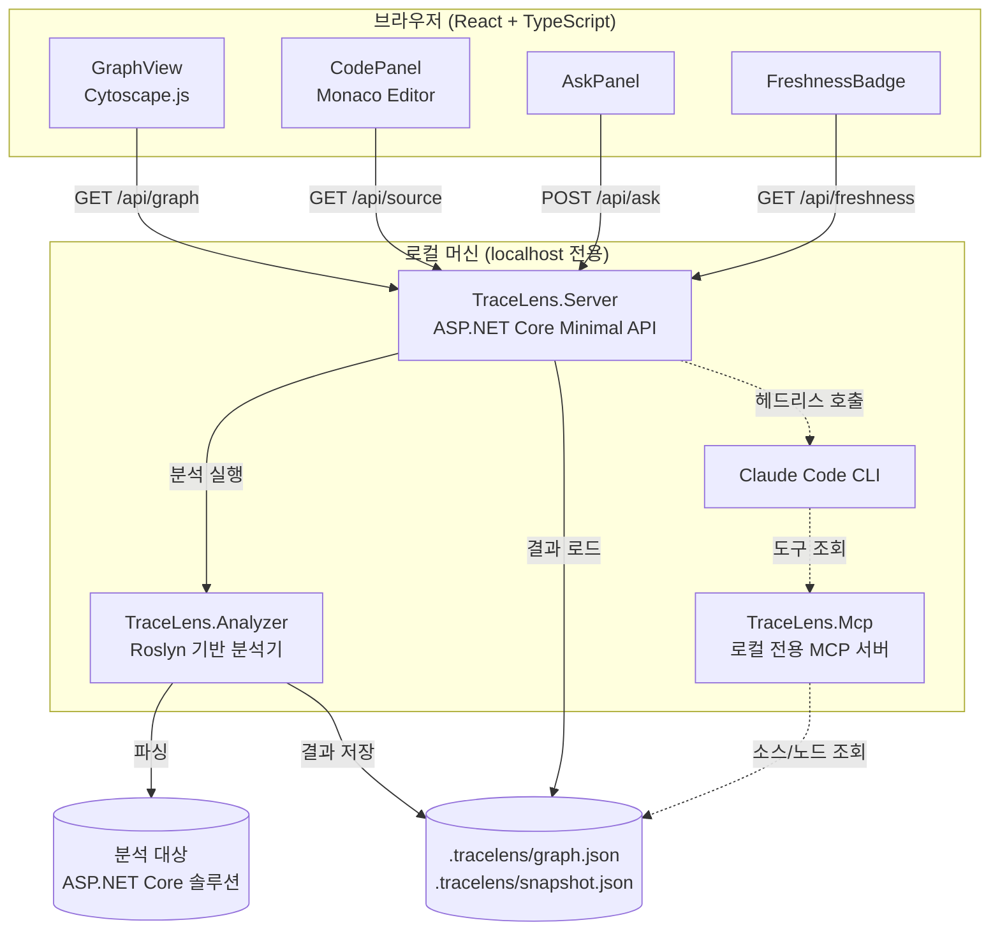

# TraceLens

ASP.NET Core Web API 코드베이스의 호출 흐름을 그래프로 탐색하고, 선택한 코드 위치를 Claude Code에게 곧바로 질의할 수 있는 로컬 개발 도구다.

## 이 도구가 하는 일

HTTP 엔드포인트(진입점)부터 시작해서 컨트롤러 → 서비스 → 리포지토리로 이어지는 실제 메서드 호출 흐름을 그래프로 보여준다. 진입점 대신 클래스 메뉴에서 클래스를 골라 그 클래스를 중심으로 볼 수도 있다. 그래프의 노드를 클릭하면 해당 위치의 실제 소스 코드가 옆에 뜨고, 필요하면 그 노드 내부의 더 세부적인 호출 흐름으로 드릴다운할 수 있다. 그래프에서 코드 위치를 고른 상태로 질문을 입력하면 파일 경로·라인 범위·심볼명이 자동으로 캡처되어 Claude Code에게 전달된다.

## 왜 만들었나

큰 ASP.NET Core 코드베이스를 새로 파악하거나 다른 사람에게 설명할 때, 코드를 눈으로 따라가며 구조를 재구성하는 데 시간이 많이 든다. 기존 오픈소스 도구들은 아키텍처 다이어그램은 잘 그려주지만 "그 노드를 클릭하면 실제 코드가 보이고, 그 자리에서 바로 AI 에이전트에게 물어볼 수 있는" 흐름까지는 지원하지 않아서 직접 만들기로 했다.

## 핵심 기능

- 진입점(HTTP 엔드포인트) 기준으로 단계식으로 펼쳐지는 호출 흐름 그래프
- 클래스 메뉴에서 클래스를 고르면 그 클래스의 메서드와 호출자/피호출자를 한 화면에 보여주는 클래스 중심 뷰(진입점에서 도달하지 못하는 클래스도 포함)
- 노드 클릭 시 실제 소스 코드로 드릴다운, breadcrumb으로 이전 단계 이동
- 선택한 위치를 Claude Code에게 질의 — 클립보드 복사 / 로컬 MCP 직접 연동 / 에디터에서 열기, 세 가지 방식 지원
- 마지막 분석 시점과 현재 코드가 같은지 보여주는 신선도 표시, 필요할 때만 수동으로 재분석
- 분석 대상은 솔루션(`.sln`)과 프로젝트(`.csproj`) 모두 지원하고, 폴더 탐색 대화상자로 골라서 지정

## 아키텍처



## 기술 스택

| 영역 | 선택 | 비고 |
|---|---|---|
| 분석기 | C# / Roslyn (Microsoft.CodeAnalysis) | 메서드 호출 관계와 파일·라인 정보를 정확히 추출 |
| 서버 | ASP.NET Core Minimal API | 그래프 서빙, 소스 서빙, React 정적 파일 호스팅을 겸함 |
| 프론트엔드 | React + TypeScript (Vite) | Cytoscape.js(그래프), Monaco Editor(코드 뷰) |
| 데이터 저장 | JSON 파일 (`.tracelens/` 아래) | 구현 단순함 우선, 필요해지면 이후 교체 검토 |
| 에이전트 연동 | Claude Code CLI + 로컬 MCP 서버 | 원격 노출 없이 로컬에서만 동작 |

## 시작하기

### 요구사항

- .NET 8 이상 SDK
- Node.js 20 이상
- Claude Code CLI (3단계 기능을 쓸 경우)

### 설치 및 실행 (명령 하나)

```powershell
git clone <repo-url> tracelens
cd tracelens

.\run.ps1
```

`run.ps1`이 클라이언트 의존성 설치 → 서버 빌드 → 클라이언트 프로덕션 빌드까지 한 번에 하고 서버를 띄운다.
클라이언트 빌드 결과는 `src/TraceLens.Server/wwwroot`로 들어가서 서버가 그대로 호스팅하므로, 브라우저에서 <http://127.0.0.1:5080> 하나만 열면 된다(준비되면 자동으로 열린다).

| 옵션 | 설명 |
|---|---|
| `.\run.ps1` | 클라이언트를 빌드해서 서버 하나로 실행한다(<http://127.0.0.1:5080>). 평소 도구를 쓸 때 쓴다. |
| `.\run.ps1 -Dev` | API 서버(5080)와 Vite 개발 서버(5173)를 함께 띄운다. 클라이언트를 고치면서 HMR로 확인할 때 쓴다. 브라우저는 <http://localhost:5173>으로 연다. |
| `.\run.ps1 -SkipBuild` | 빌드를 건너뛰고 바로 실행한다. |
| `.\run.ps1 -NoBrowser` | 브라우저를 자동으로 열지 않는다. |

Ctrl+C로 종료하며, `-Dev` 모드에서는 백그라운드로 띄운 API 서버까지 함께 정리한다.

### 직접 실행 (스크립트 없이)

```bash
# 백엔드
dotnet build
dotnet run --project src/TraceLens.Server

# 프론트엔드 (다른 터미널에서)
cd client
npm install
npm run dev
```

### 분석 대상 지정

화면 위쪽 입력란에 분석할 경로를 직접 입력하거나 **찾아보기…** 버튼으로 폴더를 탐색해서 고른다.
솔루션(`.sln`)과 프로젝트(`.csproj`)를 모두 고를 수 있고, `.csproj`를 고르면 그 프로젝트와 그 프로젝트가 참조하는 프로젝트만 분석한다(큰 솔루션에서 필요한 부분만 빠르게 볼 때 쓴다).

## 폴더 구조

세부 폴더 구조와 각 파일의 책임은 CLAUDE.md의 "저장소 구조" 절을 참고한다.

## 현재 개발 단계

전체 단계 구성과 각 단계의 상세 작업 목록, 완료 기준은 task.md에 정리되어 있다. 새로 합류하는 사람은 task.md의 체크리스트를 보면 현재 어디까지 진행됐는지 알 수 있다.

## 설계 배경

이 도구를 만들기 전에 정리한 인터랙티브 목업과 논의 과정을 `docs/concept-mockup.html`에 남겨둔다. 그래프 드릴다운과 Claude Code 연동 UX가 실제로 어떤 느낌인지 확인하려면 그 파일을 브라우저로 열어보면 된다.
