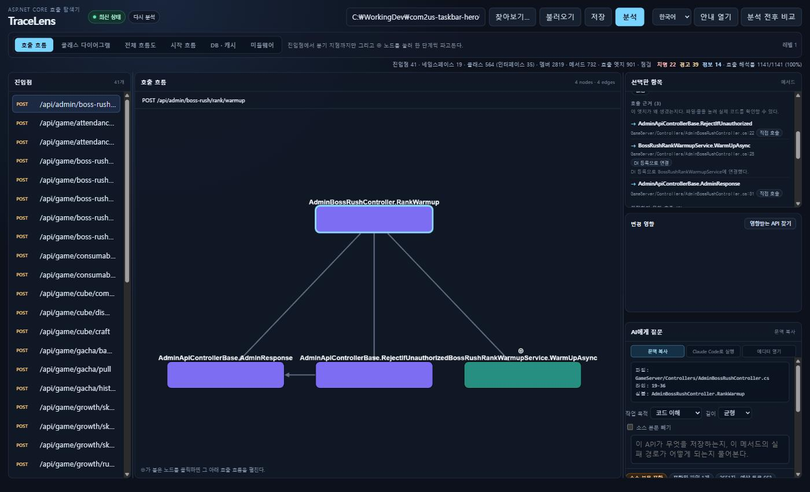
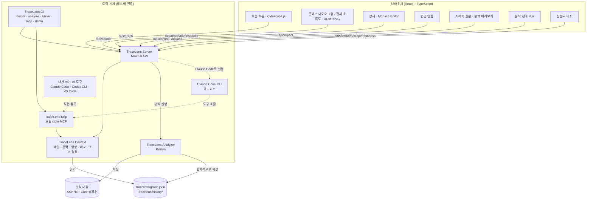

*[English](README.md) · 한국어*

# TraceLens

**ASP.NET Core Web API의 호출 경로를 코드 근거와 함께 보여 주고, AI 코딩 에이전트에 필요한 문맥을 근거까지 붙여 전달하는 로컬 개발 도구다.**

여기 나오는 모든 결과는 소스를 **정적으로** 읽어 만든 것이다. 실행 중인 요청의 이력이나 시간(런타임
분산 추적)은 수집하지 않는다 — 이름의 "Trace"는 코드의 호출 경로를 따라간다는 뜻이다.

```
# 배포물: .\tracelens.exe · 소스: dotnet run --project src/TraceLens.Cli --
1) tracelens analyze <내 .sln 또는 .csproj>       # 분석하고 .tracelens/graph.json에 저장
2) tracelens serve   --target <같은 경로>          # http://127.0.0.1:25011 에서 UI 열기
3) 진입점 선택 → 소스 근거 확인 → AI 문맥 복사     # 근거와 한계까지 함께 복사된다
4) AI가 코드를 고친 뒤 → "재분석하고 비교"         # 무엇이 달라졌는지 확인
```



*진입점 41개·클래스 564개·메서드 732개짜리 실제 다중 컨트롤러 서비스를 분석한 화면이다 — 장난감 예제가 아니다. 오른쪽 상세 패널은 엣지마다 왜 생겼는지(직접 호출·DI 등록으로 연결·유일 구현체 추정)를 보여준다. 더 많은 화면은 [docs/manual_kr.html](docs/manual_kr.html)에 있다.*

---

## 왜 필요한가

이 도구가 겨냥한 다섯 가지 상황이다. 하나같이 파일을 열어 가며 답하기엔 번거롭고, 짐작으로 답하기엔
위험한 질문들이다.

| 상황 | 도구가 없을 때 | TraceLens가 있을 때 |
|---|---|---|
| **"이 API가 정확히 뭘 하지?"** | 컨트롤러 열고, 인터페이스 찾고, 구현체 찾고, 리포지토리 찾고, 빠뜨린 분기가 없기를 바란다. | 라우트를 고르면 진입점부터 저장소까지의 경로가 한 번에 보이고, 어느 단계든 눌러 실제 소스를 읽는다. |
| **"이 코드에 대해 AI에게 물어보고 싶다"** | 파일 경로와 줄 범위를 손으로 붙여 넣고, 모델이 나머지를 지어내지 않기를 바란다. | 클릭 한 번으로 시그니처·검증된 소스·진입점까지의 경로·호출 근거, 그리고 **분석이 못 본 것**까지 담은 문맥이 만들어진다. |
| **"이 메서드를 바꾸면 뭐가 깨지지?"** | 메서드 이름으로 grep, 인터페이스 이름으로 다시 grep, DI 간접 호출이 없기를 바란다. | 호출자를 거슬러 올라가 도달하는 모든 HTTP 진입점을 근거 경로와 함께 찾는다. |
| **"이 쓰기 경로엔 트랜잭션이 없다. 2단계에서 실패하면 뭐가 남지?"** | `catch`와 조기 반환을 메서드마다 눈으로 좇는다. | "i번 단계가 실패하면 무엇이 되돌아가지 않는가"를 격자로 보여 주고, 판정마다 근거를 붙인다. |
| **"AI가 코드를 고쳤다. 실제로 뭐가 바뀌었지?"** | 텍스트 diff를 읽으며 호출 관계 변화를 알아채기를 바란다. | 저장해 둔 기준과 비교한다 — 엔드포인트·메서드 본문·호출 엣지·DB 접근·점검 결과. |

관통하는 한 가지는 **답을 확인할 수 있다**는 것이다. TraceLens가 말하는 모든 주장은 파일과 줄을
가리키고, 얼마나 확실한지를 함께 말한다.

---

## 무엇이 다른가

측정 결과가 아니라 설계에서 고른 것들이다. NDepend 같은 도구보다 낫다는 주장이 아니라, 더 좁은 자리를
고르고 몇 가지를 엄격하게 지킨다는 뜻이다.

### 1. 모든 결론에 근거가 붙는다

그래프의 엣지는 "A가 B를 부른다"로 끝나지 않는다. **어디서**(파일·줄) 불렀고 **어떻게 해석했는지**를
함께 남긴다.

| 해석 종류 | 뜻 | 확실도 |
|---|---|---|
| `Direct` | 선언된 심볼이 곧 구현이다. | 확실 |
| `DiRegistration` | 인터페이스 호출을 `AddScoped<I, Impl>` 같은 DI 등록으로 구현체까지 이었다. | 확실 |
| `SingleImplementation` | DI 등록은 없지만 솔루션 안 구현체가 하나뿐이다. | **추정** |
| `Ambiguous` | 후보가 여러 개다. **엣지를 만들지 않고** 이유만 남긴다. | — |
| `Unresolved` | 심볼을 해석하지 못했다(컴파일 오류·미지원 구문). | — |
| `External` | 솔루션 밖(프레임워크·패키지) 호출이다. 엣지를 만들지 않고 **해석률 분모에서도 뺀다.** | — |

`External`을 분모에서 빼는 이유는, 프레임워크 호출까지 세면 "해석률"이 코드베이스가 아니라
프레임워크를 얼마나 많이 쓰는지를 재는 수치가 되기 때문이다.

그래서 AI가 "이 컨트롤러는 `orders` 테이블에 쓴다"라고 답하면, 근거 `call:3`을 따라
`Controllers/OrdersController.cs:22`로 가서 직접 확인할 수 있다.

### 2. **못 본 것**을 함께 알려 준다

구멍 난 그래프와 호출이 없는 그래프는 똑같이 생겼다. TraceLens는 그 모호함을 남기지 않는다.

- **해석률**은 분모를 명시한다 — `해석한 호출 지점 / 솔루션 안 대상을 부른 검사 대상 호출 지점`. "정확도 95%" 같은 표현은 쓰지 않는다.
- **경계 목록** — 미해석·모호 호출을 따로 보여 준다. 그래서 호출자 목록이 비었다고 "아무도 안 부른다"가 되지 않는다.
- **검사하지 않은 규칙도 "꺼짐"으로 카탈로그에 남는다.** 어떤 점검이 돌지 않았는지 알 수 있다.
- 컴파일 오류가 난 프로젝트, 깊이 제한에 걸린 경로, 설정으로 제외한 네임스페이스를 모두 보고한다.
- "호출자를 찾지 못했다"를 "삭제해도 안전하다"로 바꿔 쓰지 않는다.

### 3. 문맥 계약은 하나, 목적지는 여럿

클립보드, 인앱 Claude Code 실행, MCP 도구 열두 개가 모두 **같은 엔드포인트**(`POST /api/context`)에서
나온다. 어딘가에서 조금 다르게 조립된 두 번째 문맥이 없다 — 미리보기에서 본 그대로가 모델에게 간다.

### 4. 구조적으로 로컬 전용

분석은 Roslyn으로 내 기계에서 돈다. 서버는 루프백에만 바인딩하고 외부에 여는 옵션이 없다. MCP는 로컬
stdio다. 코드가 기계 밖으로 나가는 순간은 **내가** 외부 AI에 보낼 때뿐이고, 그 전에 미리보기와 "소스
본문 빼기" 스위치, 파일 단위 제외가 있다.

### 5. 신선도는 명시적이고, 재분석은 내가 한다

배경에서 감시하지 않고 스스로 재분석하지 않는다. 대신 분석이 지금 코드와 같은지를 항상 보여 준다 —
이미 아는 파일의 수정뿐 아니라 **새로 생긴 `.cs`**와 **설정 변경**까지 잡는다. 확인할 수 없을 때는
`fresh`가 아니라 `unknown`이라고 말한다.

### 6. ASP.NET Core를 위해 만들었다

범용 의존성 그래프 도구가 아니다. 컨트롤러 특성과 Minimal API 등록, DI 수명, 미들웨어 파이프라인,
트랜잭션 없는 쓰기 경로를 이해한다 — 요청을 처리하는 코드베이스에서 실제로 묻게 되는 것들이다.

---

## 기능

### 여섯 가지 보기

툴바로 보기를 바꾼다. 왼쪽 패널과 가운데 캔버스가 한 세트로 함께 바뀌고, 오른쪽 상세·질문 열은
그대로 남는다. 세 패널의 경계선은 드래그로 조절하고 더블클릭하면 되돌아간다.

#### 호출 흐름 — 진입점 하나를 단계식으로

왼쪽에서 라우트를 고르면 그 진입점부터 가장 가까운 분기 지점까지만 그린다. `⊕`가 붙은 노드를 누르면
그 노드에서 **2홉까지** 펼친다(한 홉이 아니다 — 한 홉만 펼치면 대부분 중간 전달 메서드 하나만 나와서
다시 눌러야 한다). 한 창에 그리는 노드는 **120개**가 상한이고, 넘치면 "N개 더 있음"으로 센다.
큰 솔루션에서도 읽을 수 있게 하는 방식이다 — 노드 만 개를 한 번에 그리는 대신 궁금한 쪽으로만 들어간다.

오른쪽 상세에는 선택한 메서드의 시그니처·접근제한자·선언 클래스·라우트·직접 호출자와 피호출자,
그리고 각 엣지의 **호출 근거**가 나온다.

#### 클래스 다이어그램 — 솔루션 전체를 UML로

모든 타입을 UML 박스(이름/필드/메서드 3단)로 그린다. 기본 배치는 **트리**다. 관계 방향에 따라 층을
나누고, 층을 건너뛰는 선은 경유점으로 돌리며, 교차를 줄이도록 층마다 줄 순서를 다시 잡는다.
`→`/`↓`로 방향을 바꾸거나 **패키지** 배치로 네임스페이스별로 묶을 수 있다.

관계 4종은 각각 다른 선 모양으로 그린다.

| 관계 | 선 | 어디서 나오나 |
|---|---|---|
| 상속 | 실선 + 빈 삼각형 | `baseTypeId` |
| 구현 | 점선 + 빈 삼각형 | `interfaceIds` |
| 연관 | 실선 + 열린 화살표 | 필드·프로퍼티의 타입(주로 DI 주입) |
| 의존 | 점선 + 열린 화살표 | 위 세 관계로 설명되지 않는 호출 엣지 |

**전체를 그리는 것이 목적**이라 크기 문제의 답은 노드를 쳐내는 것이 아니라 **밀도 조절 손잡이**다.
멤버 접기, 관계 4종 개별 토글(의존은 기본 꺼짐), 네임스페이스 체크박스, "선택 1홉만", 줌
50/75/100%/맞춤. 클래스가 **150개**를 넘으면 멤버 접힘 + 의존 끔 + 맞춤 줌으로 시작하고 범위를
좁히라고 안내한다.

#### 전체 흐름도 — 진입점 지도에서 전 구간으로

기본 화면은 컨트롤러 박스와 그 라우트를 줄로 늘어놓은 클래스 단위 지도다. 라우트 줄을 누르면 그
진입점의 **메서드 단위 전 구간**으로 들어가고, 빵부스러기로 지도에 돌아온다.

도달한 메서드는 클래스 박스로 묶이고 줄 ↔ 줄로 선이 이어진다. 깊이 제한(2/3/4/전체)에 가려진 하위
호출은 그 줄 오른쪽에 `+n`으로, 자기 자신을 부르는 재귀는 `↺`로 표시한다.

#### 시작 흐름 — Program.cs가 실행되는 순서 그대로

Program.cs를 소스 순서대로 읽어 만드는 두 줄짜리 타임라인이다. **서비스 등록**(어떤 인터페이스가 어떤
구현체로, Scoped/Singleton/Transient 중 어떤 수명으로 등록됐는지)과 **미들웨어·라우팅
파이프라인**(`app.UseXxx()` / `MapXxx()`) 순서를 보여 준다. 솔루션 안에 정의된 확장
메서드(`AddFixtureServices()` 같은 것)는 접힌 채로 시작하고, 누르면 실제로 무엇을 등록하는지 펼쳐진다.

#### DB · 캐시 — 무엇을 어떤 순서로 바꾸고, 실패하면 무엇이 남는가

SQL 리터럴과 캐시 호출에서 저장소 접근을 읽어, 진입점별 실행 경로 · 클래스 × 테이블 접근 지도 ·
트랜잭션 경계 · 점검 결과로 보여 준다.

이 보기의 핵심은 **보상 처리 분석**이다. 트랜잭션 없이 저장소를 두 번 이상 건드리는 경로를 찾고, 각
단계마다 실패 경로(`catch` / 조기 `return`)에 되돌리는 호출이 있는지 확인해서 *"i번 단계가 실패하면
무엇이 남는가"*를 격자로 세운다. 빨간 칸은 그 자리에서 되돌리는 코드를 찾지 못했다는 뜻이다. 단계마다
판정이 붙는다.

| 판정 | 뜻 |
|---|---|
| `Transaction` | 트랜잭션 안이라 롤백된다. |
| `Yes` | 실패 경로에서 되돌리는 호출을 찾았다. |
| `PartialPaths` | 어떤 실패 경로는 되돌리고 어떤 경로는 되돌리지 않는다. |
| `No` | 되돌리는 것이 없다 — 그대로 남는다. |
| `NotNeeded` | 캐시 무효화처럼 다시 해도 안전해서 되돌릴 필요가 없다. |
| `Irreversible` | 취소 수단이 없다(이미 보낸 알림, append-only 원장). |

`COMP-006` 규칙은 놓치기 쉬운 경우를 잡는다 — `catch`에는 보상이 있는데 `if (!ok) return` 같은 조기
반환 경로에는 없는 경우다. 샤딩 규칙군은 `tracelens.config.json`에 샤드를 선언했을 때만 켜지므로,
쓰지도 않는 개념으로 잔소리하지 않는다.

규칙 카탈로그는 **42개**이고 그중 **기본으로 도는 것은 26개**다(꺼짐 12개, 샤드를 선언해야 켜지는 것 4개).
`COMP`(보상)·`TX`·`CACHE`·`CONN`·`RW`·`SHARD`·`PERF`·`IDX`·`MAP`·`SEC`·`MW` 그룹으로 나뉘고,
모든 점검에는 근거와 확실도가 붙으며, 돌지 않은 규칙도 목록에서 지우지 않고 "꺼짐"으로 남는다.

#### 미들웨어 — 요청이 무엇을 통과하고 어디서 끊기는가

`app.UseXxx()` 등록 순서를 그대로 세운다. 솔루션 안에 정의된 미들웨어는 `InvokeAsync` 본문을 열어
`_next` 호출을 기준으로 **요청 구간**과 **응답 구간**으로 나눈다. `_next`를 부르지 않고 끝나는 분기는
단락 지점으로 표시하고 상태 코드를 함께 보여 준다. 인증·인가·CORS 순서 문제, 생성자로 Scoped 서비스를
받는 미들웨어, 엔드포인트 매핑 뒤에 등록되어 실제로는 실행되지 않는 미들웨어도 잡는다.

---

### AI 문맥 — 에이전트를 쓸모 있게 만드는 부분

무엇이든 선택하면(진입점·메서드·클래스·네임스페이스·점검 항목·쓰기 경로·미들웨어 단계) **AI에게 질문**
패널이 작업 문맥을 만든다. 결정적인 규칙으로 조립하며 이 단계에는 LLM 호출이 없다. 담기는 순서는
이렇다.

1. **작업 목적**과 질문, 선택한 코드의 식별자
2. 분석 시각·`snapshotId`·**신선도**·분석 범위와 중요한 미해석 사유
3. 선택한 메서드의 시그니처와 **검증된** 소스 구간 — 파일이 분석 당시와 같은지에 따라 `snapshot`/`current`로 표시한다
4. 진입점에서 대상까지의 **대표 호출 경로**와 각 호출 지점의 근거
5. 직접 호출자·피호출자와 관련 DB·캐시·미들웨어 점검
6. 그래프에서 찾은 **테스트 후보** — `그래프에서 도달` / `이름 기반 후보`로 구분하며, "테스트가 통과했다"고 말하지 않는다
7. 길이 제한으로 생략한 항목과 더 조회하는 방법

**작업 목적**(코드 이해 / 변경 계획 / 수정 검토 / DB·캐시 조사) 네 가지에 따라 무엇을 먼저 담을지가
달라진다. API에는 다섯 번째 값 `Share`가 있지만 목록에 두지 않는다 — 공유 보고서 버튼이 쓰는 값이고,
소스 본문과 절대 경로를 빼는 것이 목적이라 "질문" 흐름과 섞으면 오히려 헷갈린다.
**길이**(짧게 / 균형 / 자세히)는 문자·노드·소스 줄 수의 결정적 상한으로 구현되어 있어, 같은 선택과 같은
예산이면 항상 같은 문맥이 나온다.

쓰는 방법은 세 가지다.

| 방식 | 하는 일 | 필요한 것 |
|---|---|---|
| **문맥 복사** | Markdown을 클립보드에 담는다. 어떤 AI 도구에든 붙여넣는다. 실행 가능한 노드가 없는 클래스 선택에서도 **항상** 쓸 수 있다. | 없음 |
| **Claude Code로 실행** | 브라우저 안에서 답을 스트리밍으로 받는다. 서버가 같은 문맥과 MCP 도구를 붙여 CLI를 헤드리스로 실행한다 — 별도 등록이 필요 없다. | PATH의 Claude Code CLI |
| **에디터 열기** | 선택한 위치를 VS Code로 연다(`vscode://` URI로 대체 가능). | PATH의 `code`(선택) |

보내기 전에 미리보기가 **포함한 파일, 소스 본문 포함 여부, 길이와 예상 토큰, 생략한 항목, 한계**를
보여 준다. 분석이 `stale`이면 수정용 문맥에서 소스 본문을 일부러 뺀다 — 오래된 줄 번호에 현재 코드를
붙여 놓고 "분석 당시 코드"라고 부르는 것은 거짓말이기 때문이다.

### MCP — 이미 쓰고 있는 AI 도구에 연결하기

로컬 stdio MCP 서버가 도구 열두 개를 제공한다. 질문 패널의 "MCP 연동 설정 보기"를 누르면 Claude
Code·Codex CLI·VS Code·Cursor용으로 실제 경로가 채워진 설정 조각과 **복사해서 그대로 실행하는 원라이너**가
나오고, **기존 설정을 덮어쓰지 않는다.** 같은 대화상자의 "에이전트 안내문" 탭에는 대상 저장소의
`CLAUDE.md`/`AGENTS.md`에 붙일 문단이 있다 — 이게 없으면 에이전트는 평소처럼 grep으로 헤맨다.

| 도구 | 무엇을 돌려주나 | 이렇게 물어본다 |
|---|---|---|
| `get_analysis_status` | 분석 대상·시각·신선도·지원 기능·진단. **먼저 부를 것.** 응답의 `suggestedNextTools`가 다음 도구를 알려 준다. | (무엇을 묻든 가장 먼저) |
| `get_entrypoints` | HTTP 진입점 목록 | "이 서비스에 어떤 API가 있나" |
| `get_entrypoint_flow` | 진입점 하나의 제한된 호출 경로와 경계 | "POST /api/orders가 어떤 순서로 무엇을 부르나" |
| `get_context` | UI 미리보기와 같은 작업 문맥 | "이 엔드포인트가 입력부터 저장까지 무엇을 하는지 근거 ID와 함께 설명해 줘" |
| `search_symbol` | 이름·네임스페이스로 노드 검색 | "CreateOrderAsync가 어디 있나" |
| `get_impact` | 이 메서드를 바꾸면 영향받을 수 있는 진입점 후보 | "이 메서드를 바꾸면 어떤 API가 영향을 받고 어떤 테스트가 필요한가" |
| `get_findings` | 점검과 확실도, 꺼진 규칙 목록 | "이 쓰기 경로에서 2단계가 실패하면 DB·캐시에 무엇이 남는가" (`ruleId=COMP-`) |
| `compare_snapshots` | 보관한 기준과의 차이 | "이 수정에서 의도하지 않은 호출 경로 변화가 있는가" |
| `get_node` · `get_source` · `get_callers` · `get_callees` | 노드·소스·근거가 붙은 인접 호출 | "이 줄이 실제로 무엇을 부르나" |

모든 도구는 이미 저장된 분석만 읽고 **재분석하지 않는다.** 응답에 `snapshotId`가 들어가고, 후속 호출에
`expectedSnapshotId`로 넘기면 그 사이 분석이 바뀌었을 때 `SNAPSHOT_MISMATCH`로 알려 준다. 목록 도구는
`limit`/`cursor`로 나눠 받으므로 큰 솔루션이 모델의 문맥을 통째로 채우지 않는다.

### 변경 영향 — 고치기 전에

메서드를 고르고 **영향받는 API 찾기**를 누르면 호출자를 거슬러 올라가 도달하는 모든 HTTP 진입점을
찾고, 엔드포인트마다 **대표 최단 경로 하나**와 각 단계의 근거를 돌려준다. 하나를 고르면 기존 호출 흐름
보기에서 열린다 — 여러 진입점을 읽기 어려운 한 그래프로 펼치지 않는다.

**증명하지 않는 것**은 결과에 함께 적는다. 프로퍼티·DTO 형태 변경, reflection, 외부 호출, 이벤트 구독,
런타임 DI 선택이다. "호출자를 찾지 못했다"는 *호출자를 찾지 못했다*는 뜻이지 "삭제해도 안전하다"가
아니다 — 배치나 메시지 소비자가 부를 수도 있다.

### 분석 전후 비교 — AI가 고친 뒤

**변경 전으로 저장**을 누르고, AI가 코드를 고치게 한 다음, **재분석하고 비교**를 누른다(재분석은 이때도
사용자가 눌러야 실행된다).

| 항목 | 보는 것 |
|---|---|
| 엔드포인트 | 추가·삭제와 핸들러 변경 |
| 메서드 | 추가·삭제, **시그니처** 변경, **본문** 변경 — 본문 지문은 공백·주석 변경을 무시한다 |
| 호출 | 엣지 추가·삭제, 그리고 같은 엣지의 **해석 근거·확실도 변화** |
| DB · 캐시 | 접근 추가·삭제와 트랜잭션 안팎 이동 |
| 점검 | 새로 생긴 점검과 사라진 점검 |
| 이름 변경 후보 | 본문 지문이 같은 삭제·추가 쌍 — **자동으로 확정하지 않는다** |

비교 조건을 먼저 확인한다. 대상·분석기 버전·규칙 버전·분석 범위가 다르면 "비교 조건이 다르다"고
표시한다. 규칙이 꺼져서 사라진 점검은 **비교 불가**로 보고하며 절대 "수정 완료"라고 하지 않는다.
그리고 "차이 없음"은 "안전"도 "테스트 통과"도 아니다.

### 신선도와 재분석

| 상태 | 뜻 |
|---|---|
| `fresh` | 기록한 입력과 지금 파일이 모두 같다. |
| `stale` | 바뀌거나 지워진 파일, **새로 생긴 `.cs`**, 또는 설정 변경이 있다. |
| `unknown` | 확인 범위를 벗어났다(예: 옛 형식으로 저장된 분석). 이때 `fresh`라고 하지 않는다. |

배지는 30초마다 다시 확인한다. 이 확인은 파일 목록·해시 비교일 뿐 분석을 돌리지 않는다. 추적하는
입력은 분석이 읽은 모든 소스 파일, `.sln`/`.csproj`, `tracelens.config.json`,
`Directory.Build.props/targets`, `Directory.Packages.props`, `global.json`, 그리고 프로젝트 폴더 아래
`.cs` 파일의 **집합**이다.

### 저장 · 공유 · 가져오기

- 분석 결과를 파일로 **저장**하고 나중에 재분석 없이 **불러온다**.
- 가져온 그래프는 `offlineSnapshot`으로 취급한다. 그 파일의 `rootDirectory`만으로 로컬 파일 접근을 열지 않고, 원본 루트를 연결해 입력이 일치할 때까지 소스 보기가 막혀 있으며, 대상 폴더의 활성 `graph.json`을 덮어쓰지 않는다.
- **공유 보고서**는 선택 범위만 Markdown으로 내보낸다. 기본 출력에서 절대 경로와 소스 본문을 빼고, 테이블·키 이름도 선택적으로 가릴 수 있다.

### 명령줄과 배포

```text
tracelens doctor  [--target <경로>] [--json]   환경을 점검한다. 설치·설정 변경은 하지 않는다.
tracelens analyze <경로> [--json] [--profile] [--output <폴더>] [--config <파일>]
                                               한 번 분석하고 무엇을 봤고 못 봤는지 요약한다.
tracelens serve   [--target <경로>] [--port n] [--no-browser]
                                               UI 서버를 띄운다(루프백 전용).
tracelens impact  <대상> --node <id|"Class.Method"> [--changed-files a.cs,b.cs] [--json]
                                               저장된 결과에서 영향 후보 진입점을 찾는다(재분석하지 않는다).
tracelens context <대상> --node <id> [--kind …] [--intent …] [--budget …] [--json]
                                               AI에 넘길 문맥을 표준 출력으로 낸다(기본 Markdown).
tracelens compare <대상> --baseline <snapshotId|latest> [--list] [--json]
                                               보관한 기준과 현재 분석을 비교한다.
tracelens mcp     --graph <graph.json 경로>    로컬 stdio MCP 서버를 띄운다.
tracelens demo    [--dir <복사할 위치>]         예제를 복사하고 무엇을 볼지 안내한다.
tracelens init    [--target <경로>] [--force]  tracelens.config.json을 만든다. 이미 있으면 덮어쓰지 않는다.
tracelens config  --show [--target <경로>]     기본값과 파일을 합친 유효 설정 전체를 출력한다.

같은 대상을 두 인스턴스(다른 포트)에서 동시에 분석하지 않는다. 둘 다 같은 `.tracelens/`에 쓰기 때문에
나중에 끝난 쪽이 이긴다(409 거절은 한 프로세스 안에서만 동작한다).
종료는 `Ctrl+C`, 백그라운드로 띄웠다면 `Get-Process tracelens | Stop-Process`.
```

`--no-browser`는 브라우저를 자동으로 열지 않는다(원격 셸·컨테이너에서 쓴다). `--profile`은 단계별
시간과 최대 작업 집합을 함께 출력한다.

`impact`·`context`·`compare`는 **서버를 띄우지 않고** `.tracelens/graph.json`만 읽는다. CI나 PR 훅에서
쓸 수 있게 종료 코드를 나눠 둔다(`tracelens --help`에도 같은 표가 있다).

| 종료 코드 | 뜻 | 자동화에서 할 일 |
| --- | --- | --- |
| `0` | 성공 | 결과를 그대로 쓴다. |
| `1` | 실패 | 분석 결과를 찾지 못했거나 파일을 읽지 못했다. `tracelens analyze`를 먼저 실행한다. |
| `2` | 인자 오류 | 대상이나 `--node`가 없다. 명령줄을 고친다. |
| `3` | 비교 전제 조건 불일치 | 대상·분석기 버전·규칙 버전·분석 범위가 다르다. **"차이 없음"을 안전으로 읽지 않는다.** |
| `4` | 분석 결과가 현재 소스와 다름(stale) | 출력은 옛 코드 기준이다. 재분석 후 다시 실행한다(자동 재분석은 하지 않는다). |

**분석 결과가 어디에 저장되는가.** `.sln`을 주면 그 솔루션 폴더 아래 `.tracelens/graph.json`이다.
`.csproj`를 주면 **그 프로젝트와 참조 프로젝트를 모두 담는 공통 상위 폴더** 아래에 만든다 —
프로젝트 폴더가 아니다. 실제 위치는 `analyze` 결과의 `outputPath`에 찍히고, `serve`는 대상에서
위로 8단계까지 올라가며 그 파일을 찾는다.
분석 대상이 git 저장소라면 `.gitignore`에 `.tracelens/`를 넣는 편이 좋다(`analyze`도 같은 팁을 띄운다).

`doctor`는 `SDK_NOT_FOUND`·`SDK_MISMATCH`·`TARGET_NOT_FOUND`·`UNSUPPORTED_TARGET_FORMAT`·
`OUTPUT_NOT_WRITABLE`·`PORT_IN_USE`·`MCP_HOST_MISSING` 같은 코드와 다음에 할 일을 함께 알려 준다 —
설치가 실패했을 때 그냥 실패하는 대신 무엇을 고쳐야 하는지 말해 준다.

`.\pack.ps1`은 Windows x64 portable ZIP과 .NET tool 패키지를 `artifacts/`에 만들고, 체크섬·버전·수동
검증 절차를 `manifest.txt`에 남긴다. 만들기만 하고 게시는 하지 않는다.
`-Runtimes @('win-x64','linux-x64','osx-arm64')`을 주면 RID별로 ZIP을 각각 만든다 —
**ZIP을 만든 것과 그 OS를 지원하는 것은 다르다.** 누군가 그 OS에서 doctor·analyze·serve·소스 보기를
확인하기 전까지 아래 지원 표는 그대로 둔다.

오래 걸리는 분석은 **단계**(load · entrypoints · scan · rules · save)와 실제 처리 건수로 진행 상태를
보여 준다(근거 없는 진행률 %는 만들지 않는다). **취소**할 수 있고, 취소해도 이전 분석 결과는 그대로
유지된다.

### 그 밖에 알아 둘 것

- **한국어·영어 UI.** 한국어 사전이 원본이고 영어 사전은 그 키로 타입이 제한되므로 번역 누락은 컴파일 오류가 된다. 심볼·라우트·코드·파일 경로는 번역하지 않는다. 규칙 이름·설명은 42개 모두 규칙 ID로 영어를 둔다. 개별 점검 결과 문장은 번역하지 않는다 — 실제 심볼·테이블 이름을 섞어 분석할 때 만드는 문장이라 미리 번역할 수 없고, 번역한 척하지 않는다.
- **보기 상태가 유지된다.** 보고 있던 보기·필터·선택은 새로고침과 재분석 뒤에도 남는다. 사라진 코드를 가리키던 선택만 정리된다.
- **첫 사용 안내.** 분석 전 화면은 빈 캔버스가 아니라 예제·내 프로젝트·지원 범위·레시피 4종을 보여 준다.
- **내 코드베이스에 맞출 수 있다.** `tracelens.config.json`으로 `db.queryApis`를 사내 데이터 래퍼에 맞추고, `analysisScope`·`maxCallDepth`·제외 네임스페이스를 정하고, 수집기를 개별로 끌 수 있다.

---

## 빠른 시작

### 필요한 것

| 항목 | 필요 시점 |
|---|---|
| .NET 8 이상 SDK | 항상 필요하다. 분석 대상 프로젝트를 여는 데 쓴다. |
| Node.js 20 이상 | **소스에서 빌드할 때만** 필요하다. 배포물(ZIP·.NET tool)을 쓰면 필요 없다. |
| Claude Code CLI | "Claude Code로 실행"에만 필요하다. 문맥 복사는 없어도 된다. |
| Codex CLI · VS Code | MCP를 직접 등록해 쓸 때만 필요하다([docs/mcp-setup_kr.md](docs/mcp-setup_kr.md)). |

### 배포물로 시작하기 (소스·Node.js 없이)

> **배포물은 아직 공개 배포하지 않는다.** nuget.org·GitHub Release에 올린 것이 없으므로 내려받을 곳이 없다.
> 소스가 있는 PC에서 `.\pack.ps1`로 만들어 옮기거나(만드는 PC에만 Node.js가 필요하다),
> 아래 "소스에서 실행하기"를 쓴다. 게시 채널이 생기면 이 문단을 그 링크로 바꾼다.

```powershell
# 저장소에서 만든 ZIP을 풀고
.\tracelens.exe doctor --target C:\repos\MyApp\MyApp.sln   # 환경부터 점검한다
.\tracelens.exe demo --dir C:\temp\tracelens-demo          # 예제를 복사한다
.\tracelens.exe analyze C:\temp\tracelens-demo\OrderApi\OrderApi.csproj
.\tracelens.exe serve   --target C:\temp\tracelens-demo\OrderApi\OrderApi.csproj
```

예제(`samples/OrderApi`)는 볼 만한 것들을 한곳에 모아 두었다. 컨트롤러 라우트 4개(한 메서드에 라우트
2개인 경우 포함)와 Minimal API 라우트 4개가 같은 서비스를 부르고, 트랜잭션도 보상 처리도 없는 4단계
쓰기 경로가 들어 있다.

### 소스에서 실행하기

```powershell
git clone https://github.com/jacking75/DotNetApiServerTraceLens.git tracelens
cd tracelens
.\run.ps1
```

`run.ps1`은 클라이언트 의존성 설치 → 서버 빌드 → 클라이언트 프로덕션 빌드까지 한 번에 하고 서버를
띄운다. <http://127.0.0.1:25011> 하나만 열면 된다.

| 옵션 | 설명 |
|---|---|
| `.\run.ps1` | 클라이언트를 빌드해 서버 하나로 실행한다. 평소에 쓰는 방식이다. |
| `.\run.ps1 -Dev` | API 서버(25011)와 Vite 개발 서버(25012)를 함께 띄운다. 클라이언트를 고칠 때 쓴다. |
| `.\run.ps1 -SkipBuild` | 빌드를 건너뛰고 바로 실행한다(이때는 Node.js가 없어도 된다). |
| `.\run.ps1 -NoBrowser` | 브라우저를 자동으로 열지 않는다. |

클라이언트 검증은 `cd client; npm test`(vitest)와 `npm run build`(타입 검사 포함)다.
`npm run screenshots`는 떠 있는 서버(기본 <http://127.0.0.1:25011>)에 헤드리스 Chrome으로 붙어
여섯 보기를 두 테마·두 해상도로 `docs/screenshots/`에 찍는다. 라이트 테마가 깨졌는지 눈으로 확인할 때 쓴다.

### 분석 대상 지정하기

헤더에 경로를 직접 입력하거나 **찾아보기…**로 고른다. 솔루션(`.sln`)과 프로젝트(`.csproj`) 둘 다
가능하다 — `.csproj`를 고르면 그 프로젝트와 참조하는 프로젝트만 분석하므로 큰 솔루션에서 필요한
부분만 빠르게 볼 때 좋다.

---

## 지금 지원하는 범위

| 대상 | 지원 | 비고 |
|---|---|---|
| 컨트롤러 진입점 | 지원 | `[HttpGet]` 계열 특성과 `[Route]`. 한 메서드에 라우트가 둘이면 엔드포인트도 둘이 된다. |
| Minimal API 진입점 | 지원 | `MapGet/MapPost/MapPut/MapDelete/MapPatch/MapMethods/Map`, `MapGroup` 접두사(중첩 포함), 메서드 그룹·람다·로컬 함수 핸들러. |
| 확장 메서드 안의 등록 | 지원(추정) | `app.MapFeatureEndpoints()` 형태를 깊이 4까지 따라가고, 접두사를 호출 지점에서 채웠다는 사실을 표시한다. |
| 동적 라우트 | 미지원 | 소스에 적힌 문자열을 그대로 보여 주고 **추정**으로 표시한다. |
| 인터페이스 호출 | 지원 | DI 등록으로 구현체까지 잇는다. 등록이 없으면 구현체가 하나뿐일 때만 잇고 **추정**으로 표시한다. |
| keyed·조건부 DI 등록 | 확정하지 않음 | 실행 시 어느 구현체가 쓰일지 정적으로 알 수 없어 엣지를 만들지 않고 이유를 남긴다. |
| DB·캐시 접근 | 지원(설정으로 조정) | SQL 리터럴과 캐시 호출에서 읽는다. `db.queryApis`에 사내 래퍼를 적으면 된다. |
| reflection·이벤트 구독·메시지 핸들러 | 미지원 | 호출 엣지로 만들지 않는다. |
| 대상 형식 | `.sln`, `.csproj` | `.slnx`는 지금 쓰는 MSBuildWorkspace가 열지 못해 아직 지원하지 않고, `doctor`가 그 이유를 알려 준다. |

### 지금 읽지 않는 것

아래는 **결과에서 빠진다.** 다만 조용히 사라지지는 않는다 — 인식한 개수와 이름이 분석 진단의
"인식했지만 해석하지 않은 입력"과 "HTTP 밖 실행 단위"에 남고, 알려진 것은 한계 문장으로도 올라온다.

| 읽지 않는 것 | 결과에 어떻게 남나 |
|---|---|
| EF Core · MongoDB · NHibernate 저장소 접근 | DB·캐시 접근 0건 + `dataAccess.notes`에 사유, 진단의 외부 네임스페이스 집계에 건수 |
| MediatR `Send()`→핸들러, 델리게이트·이벤트 디스패치 | 호출 엣지 없음 + 진단의 외부 네임스페이스 집계에 건수 |
| gRPC · SignalR · `BackgroundService` · 메시지 컨슈머 · Hangfire/Quartz · Azure Functions | 진입점으로 세지 않음 + 진단·진입점 목록·영향 한계에 "HTTP 밖 실행 단위 N개" |
| MVC 액션·예외 필터, `[Authorize]` 정책 | 미들웨어 보기에 단계로 나오지 않는다 |
| 전통적 라우팅(`MapControllerRoute`) | 진입점으로 세지 않고 후보 그룹 `ConventionalRouting`으로만 센다 |

클래식 `Startup.cs`(.NET Core 3.1~5)는 **읽는다** — `Program.cs`와 함께 한 타임라인으로 합친다.

지원을 확인한 조합만 적는다.

| 운영체제 | 확인 상태 |
|---|---|
| Windows 11 x64 · .NET 8 런타임 + .NET SDK | portable ZIP으로 doctor·analyze·serve·소스 보기까지 확인했다 |
| macOS · Linux | 아직 확인하지 않았다. 코드는 net8.0이라 동작할 가능성이 높지만 지원 완료로 표기하지 않는다 |

---

## 비슷한 도구와의 관계

호출자 추적이나 영향 분석을 제공하는 상용·오픈소스 도구는 이미 여럿 있다. 예를 들어 NDepend는
호출자를 통한 영향 범위 탐색과 별도의 공식 MCP 서버를 제공한다
([영향 분석 문서](https://www.ndepend.com/docs/refactoring-impact-analysis),
[MCP 서버 저장소](https://github.com/ndepend/NDepend.MCP.Server) — 별도 라이선스/평가판이 필요하다).

TraceLens는 그보다 좁게, **ASP.NET Core 요청 중심의 탐색 · 로컬 정적 분석 · 근거가 붙은 AI 문맥 전달 ·
DB·캐시 보상 처리 확인**을 하나의 사용 흐름으로 묶는 데 집중한다(MIT 라이선스). 이는 제품 포지셔닝이며
다른 도구보다 우월하다는 측정 결과가 아니다.

---

## 아키텍처



화면과 AI 에이전트가 항상 같은 답을 보는 이유가 `TraceLens.Context`다. HTTP API도 MCP 도구도 같은
색인·같은 문맥 생성기·같은 소스 접근 정책에서 답을 만든다.

## 기술 구성

| 영역 | 선택 | 비고 |
|---|---|---|
| 분석 | C# / Roslyn (Microsoft.CodeAnalysis) | 메서드 호출 관계와 파일·줄 정보를 정확히 뽑는다 |
| 공통 조회 | `TraceLens.Context` | 색인·문맥·영향·비교·소스 접근 정책. Server와 MCP가 함께 쓴다 |
| 서버 | ASP.NET Core Minimal API | 루프백에만 바인딩한다. 원격 접근 옵션은 두지 않는다 |
| 프런트엔드 | React + TypeScript (Vite) | 호출 흐름은 Cytoscape.js, 나머지 다이어그램은 DOM+SVG, 코드 보기는 Monaco |
| 저장 | `.tracelens/` 아래 JSON | 임시 파일에 쓰고 검증한 뒤 교체한다 |
| 에이전트 연동 | 로컬 stdio MCP + 선택적 Claude Code CLI 호출 | 원격 노출 없음 |
| 배포 | .NET tool + Windows portable ZIP | 웹 자원과 예제를 함께 담는다. 실행에 Node.js가 필요 없다 |

## 문서

- [docs/manual_kr.html](docs/manual_kr.html) — 화면 구성, 여섯 보기, AI 연동, 실제 사용 절차를 한 곳에 모은 사용 설명서
- [docs/mcp-setup_kr.md](docs/mcp-setup_kr.md) — Claude Code · Codex CLI · VS Code에 MCP 등록하기
- [docs/data-contract.md](docs/data-contract.md) — `graph.json` 스키마(v7)와 API·MCP 계약, 오류 코드, 버전 이행 규칙
- [CONTRIBUTING.md](CONTRIBUTING.md) — 분석 누락을 신고하는 방법과 기여 범위
- [CHANGELOG.md](CHANGELOG.md) — 릴리스 노트(수동 갱신)와 알려진 제한
- [CLAUDE.md](CLAUDE.md) — AI 코딩 에이전트를 위한 저장소 지침과 설계 제약

## 라이선스

MIT. [LICENSE](LICENSE)를 참고한다.
